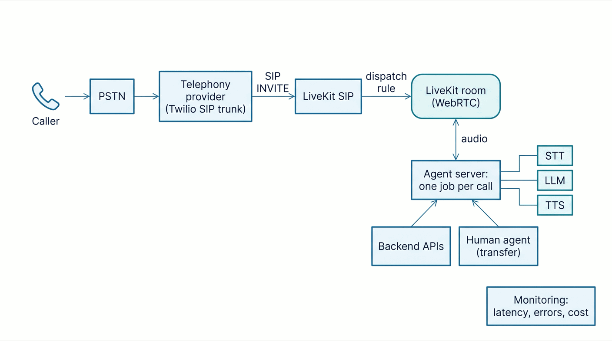
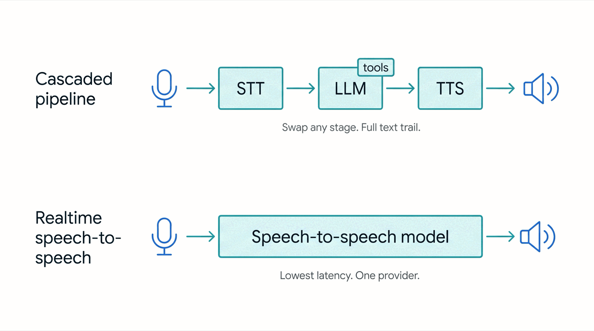
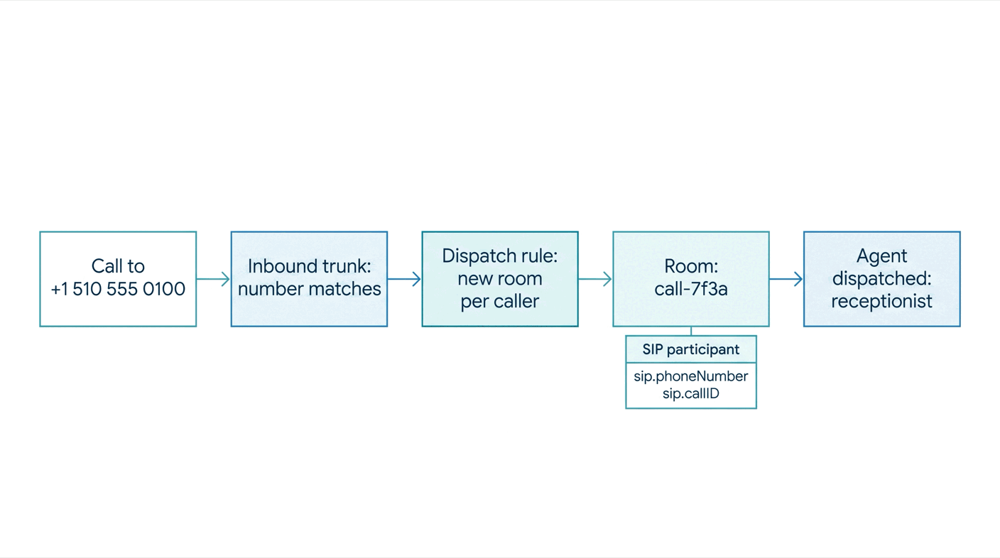
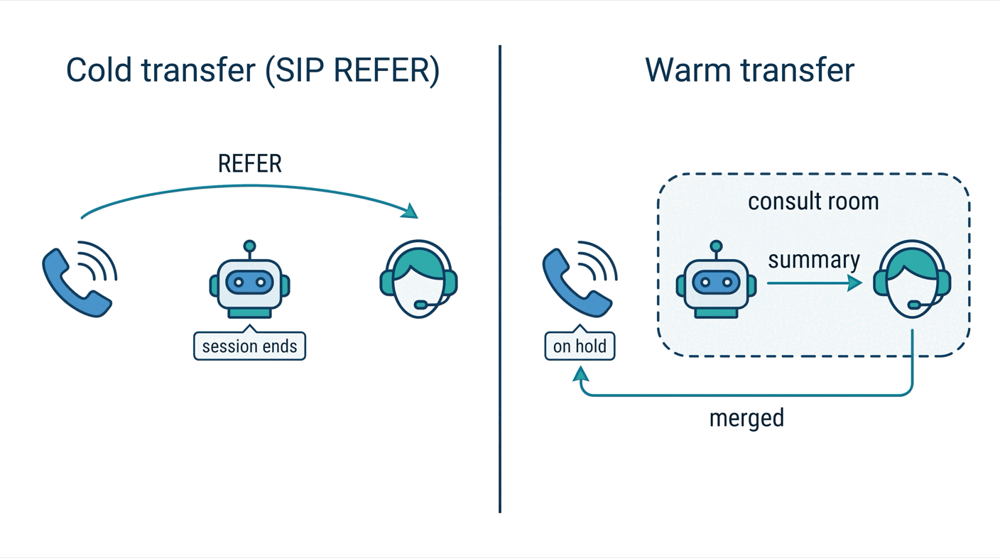
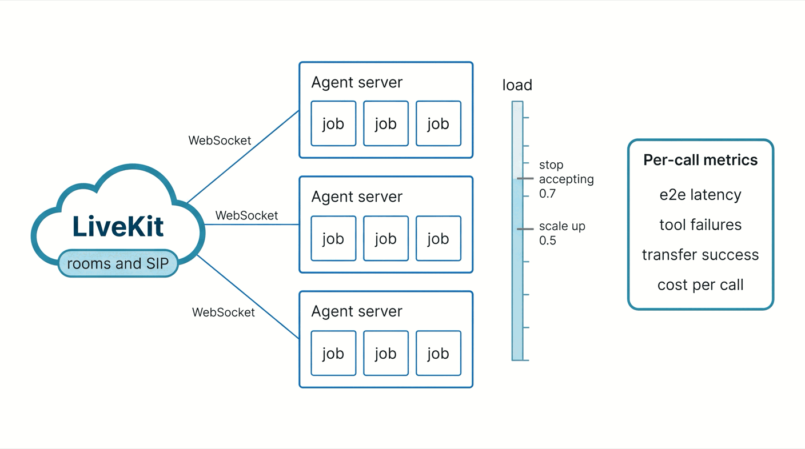

{:.no_toc}
1. this unordered seed list will be replaced by toc as unordered list
{:toc}

## Introduction: From voice AI prototype to production phone agent

A voice AI demo is a model, a microphone and a speaker. A phone agent is a distributed system. Audio arrives from a carrier over a SIP trunk, callers interrupt on bad lines, backends time out, model providers have bad minutes, and callers want a person the moment something goes wrong.

This guide builds one: an AI receptionist for a dental clinic. It answers the clinic's number, recognizes patients by caller ID, reads and books appointments through a backend API, and hands the call to the front desk when a person is needed. It runs on [LiveKit Agents](https://docs.livekit.io/agents/), the open-source framework for Python and Node.js, and the text flags what needs the managed LiveKit Cloud. Every snippet comes from one working project, and every output is what it printed.



The architecture has six parts:

1. A **telephony provider** that owns the number.
2. **SIP connectivity** that turns a call into a session participant.
3. **Real-time audio infrastructure** between the caller and the agent.
4. The **AI models**: speech-to-text, a language model and text-to-speech.
5. **Application logic**: conversation state, tools and escalation.
6. **Monitoring**: latency, errors and cost for every call.

## Step 1: Choose your real-time voice infrastructure

A phone call is not a request. Audio flows both ways at once, callers talk over the agent, and a pause of more than a second feels broken. You need a transport that moves audio frames in real time and an agent that reacts as they arrive:

- **SIP** is the phone network's signaling protocol. It sets up, transfers and ends calls, while the audio travels over RTP.
- **WebRTC** carries low-latency audio between participants and absorbs packet loss and jitter.
- A **media server** bridges the two and turns the call into a participant in a WebRTC room.

In LiveKit, the media server is the LiveKit server plus the LiveKit SIP service, both open source. A call becomes a *SIP participant* in a *room*, and LiveKit dispatches a job to an *agent server*, one process per call, which connects out over a WebSocket and needs no public ports. Run it all yourself or on LiveKit Cloud. Noise cancellation, LiveKit Inference, Agent Insights, LiveKit Phone Numbers and the participant move behind warm transfers are Cloud-only.

There are other routes. **Twilio**, the carrier here, can also stream call audio over WebSockets (Media Streams), which LiveKit Cloud accepts through its [Twilio Connector](https://docs.livekit.io/telephony/connectors/twilio/). At the fully managed end, [Voiceflow](https://docs.voiceflow.com/documentation/deploy/phone/connect-a-phone-number) runs the whole stack: you design the agent, import a Twilio or Vonage number and assign it, and calls, recordings and transcripts just work. The SDK route trades that convenience for control over every model, timeout and transfer rule.

## Step 2: Select and configure your AI models

A cascaded pipeline chains **speech-to-text (STT)**, a **large language model (LLM)** that decides what to say and which tools to call, and **text-to-speech (TTS)**. A **realtime speech-to-speech model**, such as OpenAI Realtime or Gemini Live, does all three in one.



| | Cascaded STT, LLM, TTS | Realtime speech-to-speech |
|---|---|---|
| Latency | Moderate; streaming overlaps the stages | Lowest; one model, no hand-offs |
| Changing models | Any stage, independently | One provider for the whole path |
| Tool calling | Mature, text based | Less mature |
| Debugging and audit | Text at every stage | Transcripts arrive late |
| Exact phrasing with `say()` | Yes | Not the same way |
| Cost | Three meters, each tunable | One meter |

A receptionist must read appointment data exactly and keep an auditable transcript, so it uses the cascaded pipeline, LiveKit's recommended production default. Keep the models in configuration, since prices, voices and availability change. In LiveKit Agents the pipeline is an `AgentSession` with one parameter per stage. On LiveKit Cloud, the `inference` module provides hosted models with server-side fallbacks and no provider keys:

```python
from livekit.agents import AgentSession, TurnHandlingOptions, inference

session = AgentSession(
    stt=inference.STT(model="deepgram/nova-3", language="en",
                      fallback=[{"model": "assemblyai/universal-3-6-pro"}]),
    llm=inference.LLM(model="google/gemma-4-31b-it"),
    tts=inference.TTS(model="cartesia/sonic-3", voice="9626c31c-bec5-4cca-baa8-f8ba9e84c8bc",
                      fallback=[{"model": "fishaudio/s2.1-pro", "voice": "fa4c9eb3dccc4806b382b40d61c6b10a"}]),
    turn_handling=TurnHandlingOptions(
        turn_detection=inference.TurnDetector(),
        endpointing={"min_delay": 0.5, "max_delay": 3.0},
        interruption={"min_duration": 0.5},
    ),
)
```

Self-hosted, the same session takes provider plugins and your own keys, and nothing else changes. The receptionist picks one with a `MODEL_PROVIDER` variable, and the calls in this guide ran on the plugin version:

```python
from livekit.plugins import openai, silero

session = AgentSession(
    stt=openai.STT(model="gpt-4o-mini-transcribe", use_realtime=True),  # streaming transcripts
    llm=openai.LLM(model="gpt-4.1-mini"),
    tts=openai.TTS(model="gpt-4o-mini-tts", voice="coral"),
    vad=silero.VAD.load(),
    turn_handling=TurnHandlingOptions(turn_detection="vad", endpointing={"min_delay": 0.5, "max_delay": 3.0}),
)
```

## Step 3: Connect your AI agent to the telephone network

The **PSTN** is the public phone network. A **SIP trunk** connects it to your system: the provider owns the number and forwards each call as a SIP INVITE. LiveKit mirrors the trunk with an **inbound trunk**, which claims the number, and a **dispatch rule**, which picks the room and the agent.



**Get a number.** LiveKit Cloud sells US numbers through [LiveKit Phone Numbers](https://docs.livekit.io/telephony/start/phone-numbers/), which need only a dispatch rule. With Twilio, create an Elastic SIP trunk, point its origination URI at your LiveKit SIP endpoint (your project ID without `p_`, followed by `.sip.livekit.cloud`), and attach the number:

```bash
twilio api trunking v1 trunks create --friendly-name "Harbor Dental" --domain-name "harbor-dental.pstn.twilio.com"
twilio api trunking v1 trunks origination-urls create --trunk-sid <TRUNK_SID> --friendly-name "LiveKit SIP" \
  --sip-url "sip:<subdomain>.sip.livekit.cloud;transport=tcp" --weight 1 --priority 1 --enabled
twilio api trunking v1 trunks phone-numbers create --trunk-sid <TRUNK_SID> --phone-number-sid <NUMBER_SID>
```

**Create the inbound trunk and the dispatch rule.** The rule puts each caller in a fresh room and dispatches the agent named `receptionist`:

```json
{ "trunk": { "name": "Harbor Dental inbound", "numbers": ["+15105550100"] } }
```

```json
{
  "dispatch_rule": {
    "name": "Harbor Dental receptionist",
    "trunk_ids": ["ST_TgirZ2Wz75YG"],
    "rule": { "dispatch_rule_individual": { "room_prefix": "call-" } },
    "room_config": { "agents": [{ "agent_name": "receptionist", "metadata": "{\"clinic\": \"harbor-dental\"}" }] }
  }
}
```

```bash
lk sip inbound create inbound-trunk.json
lk sip dispatch create dispatch-rule.json
lk sip dispatch list
```

```
┌───────────────────┬────────────────────────────┬─────────────────┬─────────────────────┬─────────────────────────┬──────────────┐
│ SipDispatchRuleID │ Name                       │ SipTrunks       │ Type                │ RoomName                │ Agents       │
├───────────────────┼────────────────────────────┼─────────────────┼─────────────────────┼─────────────────────────┼──────────────┤
│ SDR_w4oMyPKcc2qT  │ Harbor Dental receptionist │ ST_TgirZ2Wz75YG │ Individual (Caller) │ call-_<caller>_<random> │ receptionist │
└───────────────────┴────────────────────────────┴─────────────────┴─────────────────────┴─────────────────────────┴──────────────┘
```

Create both once and reuse them for every call. Pin the rule to your trunk with `trunk_ids`, since a rule without it matches every trunk. The `metadata` reaches the agent as `ctx.job.metadata`, so one agent can serve several clinics.

**Answer the call.** LiveKit SIP matches the trunk and the rule, creates the room with the caller in it, and dispatches a job to an agent server registered under the same `agent_name`. The caller's number arrives as a participant attribute, so the receptionist finds the patient before saying a word:

```python
server = AgentServer()

@server.rtc_session(agent_name="receptionist", on_session_end=on_session_end)
async def receptionist(ctx: JobContext) -> None:
    await ctx.connect()
    participant = await ctx.wait_for_participant()

    customer = None
    if participant.kind == rtc.ParticipantKind.PARTICIPANT_KIND_SIP:
        phone = participant.attributes.get("sip.phoneNumber", "")
        logger.info("inbound call from %s to %s (call %s)", phone,
                    participant.attributes.get("sip.trunkPhoneNumber"), participant.attributes.get("sip.callID"))
        try:
            customer = await clinic_api("GET", "/customers", params={"phone": phone})
        except ToolError:
            customer = None  # greet anonymously; the agent can identify the caller later

    session = build_session()
    observe(session)
    await session.start(room=ctx.room, agent=Receptionist(customer), room_options=room_options())

    # A scripted greeting goes straight to TTS: no LLM round trip before the caller hears a voice.
    who = f"Hello {customer['name'].split()[0]}, " if customer else "Hello, "
    await session.say(f"{who}this is Ava from Harbor Dental Clinic, how can I help you today?")
```

**Check it with a call.** A number that rings without an answer has no agent registered under that name. A call that connects to silence has an agent that publishes no audio. A healthy call looks like this in the agent log:

```
INFO livekit.agents - registered worker {"agent_name": "receptionist", "id": "AW_MMW9r2DMkYYP", "url": "ws://localhost:7880"}
INFO livekit.agents - received job request {"job_id": "AJ_8pRxKpmvNjmf", "room": "call-_+15550002_BFK5wQ3zB25J", "agent_name": "receptionist"}
INFO receptionist - inbound call from +15550002 to +15105550100 (call SCL_LeFbnPRqGmDK)
```

`lk room list` shows the `call-` room while the call is up, and `lk room participants get` prints the SIP attributes, including `sip.twilio.callSid` for finding the call in the Twilio console.

**Outbound calls and existing phone systems.** Outbound calls, and the warm transfer in Step 5, need an outbound trunk with the provider's termination address, credentials and the caller ID to present. Your code dials with `CreateSIPParticipant`. A PBX or contact center connects the same way, as a trunk in either direction.

```json
{ "trunk": { "name": "Harbor Dental outbound", "address": "harbor-dental.pstn.twilio.com",
             "numbers": ["+15105550100"], "auth_username": "<user>", "auth_password": "<password>" } }
```

## Step 4: Implement conversations, interruptions, and backend integrations

**Conversation state.** `AgentSession` keeps the history (turns, tool calls and results) and sends it to the LLM every turn. Anything else lives on the agent. The receptionist stores the identified patient and says so in its instructions, because without that line the model asks known callers for their number anyway:

```python
class Receptionist(Agent):
    def __init__(self, customer: dict | None = None) -> None:
        end_call = EndCallTool(
            extra_description="Only end the call after the caller confirms they need nothing else.",
            end_instructions="Thank the caller for calling Harbor Dental Clinic and say goodbye.",
        )
        instructions = INSTRUCTIONS
        if customer:  # matched by caller ID before the session started
            instructions += (f"\nThe caller ID matches the patient {customer['name']} (id {customer['id']}), "
                             "so they are already identified: do not ask for their phone number.")
        super().__init__(instructions=instructions, tools=end_call.tools)
        self.customer = customer
```

**Turns and interruptions.** Voice activity detection (VAD) finds speech, and turn detection decides the caller has finished; LiveKit's default turn detector model weighs both the sound and the meaning of the words. When the caller talks over the agent, the agent stops, trims its history to what the caller heard, and answers the new words, so "actually, make it Thursday" needs no extra code. The sessions above wait 0.5 to 3 seconds before closing a turn, and the Cloud one ignores interruptions under half a second, which filters coughs. LiveKit Cloud's adaptive interruption model also tells "mm-hm" from a real interruption; without Cloud credentials the agent falls back to VAD:

```
INFO livekit.agents - adaptive interruption disabled due to unrecoverable error, falling back to VAD-based interruption
```

**Tools.** A method decorated with `@function_tool` is a tool, and its docstring and type hints become the schema the LLM sees. The receptionist calls a clinic API through the job's shared HTTP session with a four-second timeout, and turns every failure into a message the model can act on:

```python
async def clinic_api(method: str, path: str, **kwargs: Any) -> Any:
    http = utils.http_context.http_session()
    try:
        async with http.request(method, f"{BACKEND_URL}{path}", timeout=aiohttp.ClientTimeout(total=4), **kwargs) as resp:
            if resp.status == 404:
                return None
            data = await resp.json()
            if resp.status >= 400:
                raise ToolError(data.get("error", f"clinic system error {resp.status}"))
            return data
    except (aiohttp.ClientError, asyncio.TimeoutError) as exc:
        raise ToolError("The clinic system is not responding. Apologize, and offer a transfer or a callback.") from exc


class Receptionist(Agent):
    @function_tool()
    async def get_appointments(self, ctx: RunContext) -> list[dict]:
        """List the identified caller's upcoming appointments."""
        if self.customer is None:
            raise ToolError("The caller is not identified yet. Ask for the phone number on file.")
        return await clinic_api("GET", f"/customers/{self.customer['id']}/appointments")

    @function_tool()
    async def book_appointment(self, ctx: RunContext, day: str, time: str, service: str) -> dict:
        """Book an appointment for the identified caller. Call it only after they said yes.

        Args:
            day: The date in YYYY-MM-DD format.
            time: The start time in 24 hour HH:MM format.
            service: The service, for example "dental cleaning".
        """
        ctx.disallow_interruptions()  # a write must finish even if the caller keeps talking
        if self.customer is None:
            raise ToolError("Identify the caller before booking.")
        return await clinic_api("POST", "/appointments",
                                json={"customer_id": self.customer["id"], "service": service, "start": f"{day}T{time}"})
```

Three rules keep tools safe on a phone line. Lookups may be interrupted, and their results stay in the history. Writes call `ctx.disallow_interruptions()` first, because a booking cut in half has no rollback. And a `ToolError` reaches the LLM instead of crashing the call, so the caller hears an apology instead of an invented appointment. The receptionist can book but not cancel, and only after a spoken yes.

## Step 5: Add human call transfers and failure handling

An agent with no way out is a dead end. The receptionist hands the call over when the caller asks for a person, for billing, insurance, complaints or medical questions, and after two failed attempts.



A **cold transfer** forwards the call with a SIP REFER: the carrier connects the caller to the new number and the agent drops out. A **warm transfer** puts the caller on hold, calls the human into a private room, briefs them and merges the calls, so nobody explains the problem twice. The receptionist goes warm for billing, insurance and complaints, and cold when the caller just wants a person.

**Cold transfer.** `TransferSIPParticipant` sends the REFER. The caller's participant identity is not the phone number, so `sip_caller()` finds the caller by participant kind:

```python
@function_tool()
async def transfer_to_human(self, ctx: RunContext, reason: str) -> str | None:
    """Cold transfer to the front desk. Call it only after the caller agreed to it."""
    ctx.disallow_interruptions()
    line = sip_caller()  # (job, SIP participant), or None outside a phone call
    if line is None:
        return "There is no phone line to transfer. Offer a callback instead."
    job, caller = line
    await ctx.session.say("Transferring you to the front desk now.", allow_interruptions=False)
    try:
        await job.api.sip.transfer_sip_participant(api.TransferSIPParticipantRequest(
            room_name=job.room.name,
            participant_identity=caller.identity,
            transfer_to=FRONT_DESK_URI,  # "tel:+1..." on Twilio, "sip:+1...@host" on most PBXs
            play_dialtone=True,
        ))
    except api.SipCallError as exc:  # the front desk rejected the call or did not answer
        logger.warning("transfer failed: SIP %s %s", exc.sip_status_code, exc.sip_status)
        return "The front desk did not answer. Apologize and offer to take a message or arrange a callback."
    except api.ServerError:
        return "The transfer could not be started. Apologize and offer a callback."
    return None  # the caller has left the room
```

The trunk must allow transfers; on Twilio, run `twilio api trunking v1 trunks update --sid <SID> --transfer-mode enable-all`. The target format depends on the carrier. Twilio takes `tel:+15105550199`, while a PBX such as Asterisk answers a `tel:` target with `400 Bad Request` and needs `sip:+15105550199@host`. A front desk that rejects the call or doesn't answer within `ringing_timeout` (30 seconds by default) raises `SipCallError`, and the caller is still on the line to be offered a callback.

**Warm transfer.** The prebuilt `WarmTransferTask` (Python `beta.workflows`) plays hold music, dials the front desk through the outbound trunk, has a second agent brief them from the chat history, and moves them into the caller's room once they accept:

```python
@function_tool()
async def transfer_with_handoff(self, ctx: RunContext, summary: str) -> str | None:
    """Warm transfer: put the caller on hold, brief the front desk, then connect them."""
    ctx.disallow_interruptions()
    if sip_caller() is None:
        return "There is no phone line to transfer. Offer a callback instead."
    if not ON_LIVEKIT_CLOUD:  # the merge uses MoveParticipant, a LiveKit Cloud API
        return "Warm transfers are not available here. Use transfer_to_human; the caller already agreed."
    await ctx.session.say("Please hold while I brief the front desk.", allow_interruptions=False)
    try:
        result = await WarmTransferTask(
            sip_call_to=FRONT_DESK_NUMBER,
            sip_trunk_id=os.environ["LIVEKIT_SIP_OUTBOUND_TRUNK"],
            chat_ctx=self.chat_ctx,
            extra_instructions=f"Context for the front desk: {summary}",
            ringing_timeout=30.0,
        )
    except ToolError:  # no answer, voicemail, or the front desk declined
        return "The front desk could not take the call. Apologize, then offer a cold transfer or a callback."
    await ctx.session.say("You're now connected with the front desk. Goodbye!", allow_interruptions=False)
    ctx.session.shutdown()  # the agent leaves; the caller and the front desk stay in the room
    return None
```

Three details matter. The merge calls the `MoveParticipant` API, which only LiveKit Cloud implements: a self-hosted server dials and briefs the front desk, then answers the merge with `not implemented`. The room must outlive the agent, so the room options set `delete_room_on_close=False`. And no answer, voicemail or a decline ends the task with a `ToolError`, which brings the agent back to the caller. Here is a billing call on a self-hosted server, where the warm path hands over to the cold one, from the agent and the LiveKit SIP service:

```
# agent (local time)
13:17:50 DEBUG livekit.agents - executing tool {"function": "transfer_with_handoff", ...}
13:17:51 DEBUG livekit.agents - executing tool {"function": "transfer_to_human", ...}
13:17:51 INFO  receptionist - transferring sip_+15550002 to sip:+15105550199@asterisk (The patient Maria Lopez called reporting being charged twice on their last bill and needs assistance with billing.)
# LiveKit SIP service (UTC)
12:17:55.918Z INFO sip transferring SIP call {"callID": "SCL_Gfe6warmSi7b", "transferTo": "<sip:+15105550199@asterisk>"}
12:17:56.938Z INFO sip inbound call transferred {"callID": "SCL_Gfe6warmSi7b"}
```

**Other failures.** A backend timeout becomes a `ToolError` and an apology, not silence. Model outages switch providers through the `fallback` lists in Step 2 on LiveKit Cloud, or through `stt.FallbackAdapter`, `llm.FallbackAdapter` and `tts.FallbackAdapter` self-hosted, and the session's `error` event says whether a failure is recoverable. A hang-up closes the session with `participant_disconnected`, and the prebuilt `EndCallTool` lets the agent end a finished call cleanly.

## Step 6: Deploy, monitor, and scale your AI phone agent



In production the agent is a container running `python agent.py start`, which registers with LiveKit and waits for jobs. LiveKit's Dockerfile template builds in two stages and runs as a non-root user:

```dockerfile
ARG PYTHON_VERSION=3.12
FROM python:${PYTHON_VERSION}-slim AS base
ENV PYTHONUNBUFFERED=1
ENV PIP_DISABLE_PIP_VERSION_CHECK=1

FROM base AS build
RUN apt-get update && apt-get install -y gcc g++ python3-dev && rm -rf /var/lib/apt/lists/*
WORKDIR /app
COPY requirements.txt ./
RUN python -m venv .venv
ENV PATH="/app/.venv/bin:$PATH"
RUN pip install --no-cache-dir -r requirements.txt
COPY . .

FROM base
ARG UID=10001
RUN adduser --disabled-password --gecos "" --home "/app" --shell "/sbin/nologin" --uid "${UID}" appuser
WORKDIR /app
COPY --from=build --chown=appuser:appuser /app /app
ENV PATH="/app/.venv/bin:$PATH"
USER appuser
CMD ["python", "agent.py", "start"]
```

The image is 1.01 GB. In `start` mode the agent answers a health check on port 8081 and writes JSON logs, ready for a log drain. On LiveKit Cloud, `lk agent create` builds and deploys it, `lk agent deploy` ships new versions, `lk agent logs` tails them, and `--region` keeps the agent near your callers.

**Capacity.** Each call is a job in its own process. LiveKit suggests 4 cores and 8 GB per agent server to start, for 10 to 25 concurrent calls depending on the models you run locally. A server stops taking jobs above `load_threshold` (CPU, 0.7 by default), so scale out earlier, around 0.5. Give servers a grace period of ten minutes or more, so calls finish before shutdown.

**Latency.** Every message in the history carries a `metrics` report. Log it per turn to see where the time goes:

```python
@session.on("conversation_item_added")
def _on_item(ev: ConversationItemAddedEvent) -> None:
    if not isinstance(ev.item, ChatMessage):
        return
    m = ev.item.metrics
    if ev.item.role == "user" and m.get("end_of_turn_delay") is not None:
        logger.info("user turn: end_of_turn=%.2fs transcription=%.2fs",
                    m["end_of_turn_delay"], m.get("transcription_delay") or 0.0)
    elif ev.item.role == "assistant" and m.get("e2e_latency") is not None:
        logger.info("agent turn: e2e=%.2fs llm_ttft=%.2fs tts_ttfb=%.2fs",
                    m["e2e_latency"], m.get("llm_node_ttft") or 0.0, m.get("tts_node_ttfb") or 0.0)
```

```
13:18:26,334 INFO  receptionist - user turn: end_of_turn=1.21s transcription=1.21s
13:18:26,877 DEBUG livekit.agents - executing tool {"function": "get_appointments", "lk.pii.arguments": "{}"}
13:18:38,520 INFO  receptionist - agent turn: e2e=3.45s llm_ttft=0.50s tts_ttfb=1.00s
```

Maria's appointment question took 3.45 seconds from her last word to the agent's first, and tamesu measured 3.2 seconds at her end of the line (Step 7): over three times the one-second budget. The log shows where it went: 1.21 seconds to close the turn while the final transcript arrived, half a second for the LLM to call `get_appointments`, another half second to start the answer, and a full second to the first TTS audio. Each number points to a fix: an STT with faster finals or its own endpointing, the turn detector model instead of plain VAD, a short filler before slow tools, and models served close to your agent servers.

**What to watch.** These six numbers tell you whether the agent is healthy, and the SDK already has the data for all of them:

| Metric | Where it comes from |
|---|---|
| Call connection and completion | SIP participant attributes and the session `close_reason` |
| Response latency | `e2e_latency` per turn, as p50 and p95 |
| STT, LLM and TTS errors | the `error` event and the report's `errors` counters |
| Tool failures | `ToolError` raises in your logs |
| Transfer success | the outcome each transfer tool logs |
| Cost per call | `session.usage` per model, plus the carrier's per-minute rate |

After a test call, the session report from `ctx.make_session_report()` answers most questions in one file. An excerpt from the appointment call:

```json
{
  "room": "call-_+15550002_BFK5wQ3zB25J",
  "duration_ms": 47621,
  "user_turns": 2,
  "close_reason": "CR_USER_INITIATED",
  "errors": { "llm": 0, "stt": 0, "tts": 0, "realtime": 0, "interruption": 0 },
  "usage": [
    { "model": "gpt-4.1-mini", "input_tokens": 3193, "output_tokens": 73 },
    { "model": "gpt-4o-mini-tts", "input_tokens": 69, "output_tokens": 561, "audio_duration": 21.77 },
    { "model": "gpt-4o-mini-transcribe", "input_tokens": 90, "output_tokens": 30, "audio_duration": 8.94 }
  ]
}
```

On LiveKit Cloud the same data appears per session in Agent Insights, with recordings and traces, and log drains forward logs to Datadog, CloudWatch, Sentry or New Relic. Self-hosted, store the report yourself and export traces with OpenTelemetry.

## Step 7: Test the complete calling workflow before launch

Local audio tests prove the pipeline works. They don't prove that the number rings the agent, that caller ID arrives, that the line leaves the STT enough signal, or that a transfer reaches the front desk. Test in three layers.

**Unit tests on every commit.** `session.run()` plays one turn as text and returns what happened. You get assertions for messages and tool calls, an LLM judge for intent, and `mock_tools` to make a tool fail on purpose:

```python
def called(result, name: str) -> bool:
    try:
        result.expect.contains_function_call(name=name)
        return True
    except AssertionError:
        return False

@pytest.mark.asyncio
async def test_billing_gets_a_warm_transfer(clinic_backend):  # fixture: the mock clinic API
    async with openai.LLM(model="gpt-4.1-mini") as judge, AgentSession(llm=judge) as session:
        await session.start(Receptionist(customer=MARIA))
        first = await session.run(user_input="I was charged twice on my last bill. Can I talk to someone?")
        second = await session.run(user_input="Yes please, transfer me.")
        assert any(called(r, "transfer_with_handoff") for r in (first, second)), "no warm transfer"
        await second.expect[-1].is_message(role="assistant").judge(
            judge, intent="Explains the transfer is not possible right now and offers a callback or to take a message.")
```

```
$ pytest -q
7 passed in 22.13s
```

The seven tests cover the greeting, the lookup, confirmation before booking, both transfers and a backend outage. Write judge intents without ambiguity: "offers a transfer or a callback" can fail an agent that offers only a transfer, while "offers at least one alternative" doesn't.

**Simulated callers on every pull request.** [Agent Simulations](https://docs.livekit.io/testing/simulations/), a LiveKit Cloud feature, run an LLM-driven caller with a goal against your real agent and grade the whole conversation. Run each scenario several times, since the caller and the judge are both models.

**Real phone calls before launch.** [tamesu](https://xavidop.github.io/tamesu/docs/) is an open-source testing framework whose `sip` target calls your agent through a trunk you bring, like a customer would. A persona with a goal talks through TTS and listens through VAD and STT, can interrupt or add background noise, and deterministic checks plus LLM judges grade the call, whatever the agent was built with. The SIP target needs the full build from the [releases page](https://github.com/xavidop/tamesu/releases); the Homebrew cask installs the lite build, which has no SIP.

```yaml
suite: receptionist-phone
targets:
  clinic:
    type: sip
    direction: outbound
    to: "+15105550100"   # the clinic
    from: "+15550002"    # Maria's number, so the agent should recognize her
    ring_timeout: 30s
    max_call_duration: 3m
tests:
  - name: a patient asks for her next appointment
    target: clinic
    persona: { name: Maria, style: "polite", language: en, voice: en-US-female }
    scenario:
      script:
        - wait_for: "Harbor Dental Clinic"   # a real caller waits for the greeting
      goal: "You are Maria Lopez. Find out when your next appointment is, then say goodbye."
      max_turns: 4
      stop_when: "the agent has said the date and time of the next appointment"
    assert:
      - judge: "The agent greets Maria by name and says her next appointment is a dental cleaning on November 12 at 10 in the morning"
      - metric: { name: greeting_ms, lt: 3000 }   # call answered to the agent's first word
  - name: a billing question reaches the front desk
    target: clinic
    persona: { name: Maria, style: "firm", language: en, voice: en-US-female }
    scenario:
      script:
        - wait_for: "Harbor Dental Clinic"
      goal: "You were charged twice on your last bill and want to talk to a person. Say yes to a transfer. When someone from the front desk answers, say thanks and goodbye."
      max_turns: 5
      stop_when: "someone from the front desk has answered the call"
    assert:
      - judge: "The agent offers to transfer the billing question, and then a person from the front desk answers the call"
      - call_ended_by: [agent, caller]
```

Without the `wait_for` step, the simulated caller starts talking the moment the call connects, right over the greeting. `tamesu sip setup` creates the outbound trunk on your LiveKit SIP service, `tamesu doctor` checks the secrets, the models and the SIP service, and `tamesu run` places the calls and keeps a transcript, a stereo recording and the call timeline of each one:

```
$ tamesu run
tamesu run: 2 tests, output in .tamesu/runs/2026-11-09T14-16-40
PASS   receptionist-phone / a billing question reaches the front desk  47.6s
PASS   receptionist-phone / a patient asks for her next appointment  48.2s
2 passed, 0 failed, 0 errors in 1m36s · 14 model calls, 3892 tokens, $0.0087 · llm cache: 0 hits, 6 misses
```

**Pre-launch checklist**

- The number rings the agent from mobiles, landlines and withheld caller IDs.
- Known patients are found by caller ID, and unknown callers still get help.
- Every tool has a timeout and a `ToolError` path, and the agent never states data it did not receive.
- Writes need a spoken yes and cannot be interrupted, and the agent has no tool it should not have.
- Transfers work on a real call, and a failed transfer brings the caller back to the agent.
- Hang-ups, silence and network drops leave no rooms or jobs behind.
- Latency, errors, transfer outcomes and usage are logged and charted per call.
- Simulated callers at peak load plus a margin stay under `load_threshold`.
- The hard cases pass: speakerphone in a car, accents, interruptions, long silences, requests the agent has no tool for, a backend or model provider down, and a front desk that doesn't answer.
- Caller ID alone never unlocks sensitive actions, callers hear a recording notice where consent is required, recordings and transcripts expire, and keys live in a secret store.
- Every model or prompt change reruns all of the above.

## Conclusion: Building reliable AI phone agents

An AI phone agent is a complete application, not a language model wired to a microphone. What makes it production ready is invisible in a demo: a trunk and a dispatch rule that reliably reach the agent, swappable models, turn handling tuned for phone lines, tools with timeouts and limits, an escalation path that works when nobody picks up, and metrics for every call.

Keep those parts modular, with narrow interfaces between them. Then you can test each one alone, replace a model when a better one ships, and scale agent servers without touching the trunk.

## Resources and documentation

- [LiveKit Agents](https://docs.livekit.io/agents/), the [voice AI quickstart](https://docs.livekit.io/agents/start/voice-ai/) and [pipeline types](https://docs.livekit.io/agents/models/pipelines/)
- [Turns and interruptions](https://docs.livekit.io/agents/logic/turns/) and [function tools](https://docs.livekit.io/agents/logic/tools/definition/)
- [Telephony](https://docs.livekit.io/telephony/): [inbound trunks](https://docs.livekit.io/telephony/accepting-calls/inbound-trunk/), [dispatch rules](https://docs.livekit.io/telephony/accepting-calls/dispatch-rule/), [Twilio](https://docs.livekit.io/telephony/start/providers/twilio/) and [testing your setup](https://docs.livekit.io/telephony/testing/)
- [Call transfers](https://docs.livekit.io/telephony/features/transfers/), [WarmTransferTask](https://docs.livekit.io/agents/prebuilt/tasks/warm-transfer/) and the [warm transfer example](https://github.com/livekit/agents/tree/main/examples/warm-transfer)
- [Deployment](https://docs.livekit.io/deploy/agents/), [self-hosted deployments](https://docs.livekit.io/deploy/custom/deployments/) and [metrics and data hooks](https://docs.livekit.io/testing/observability/data/)
- [Testing](https://docs.livekit.io/testing/): [unit tests](https://docs.livekit.io/testing/unit-tests/) and [Agent Simulations](https://docs.livekit.io/testing/simulations/)
- [tamesu](https://xavidop.github.io/tamesu/docs/): the [SIP target](https://xavidop.github.io/tamesu/docs/targets/sip/) and [SIP setup](https://xavidop.github.io/tamesu/docs/sip-setup/)
- [Voiceflow phone numbers](https://docs.voiceflow.com/documentation/deploy/phone/connect-a-phone-number) and the [LiveKit Twilio Connector](https://docs.livekit.io/telephony/connectors/twilio/)

Versions used: LiveKit Agents 1.8.10 on Python 3.12, LiveKit CLI 2.19.3, a self-hosted livekit-server 1.13.11 and LiveKit SIP service 1.10 with Asterisk as the carrier, tamesu 1.20.1, and GPT-4.1 mini for the agent and the judges.
