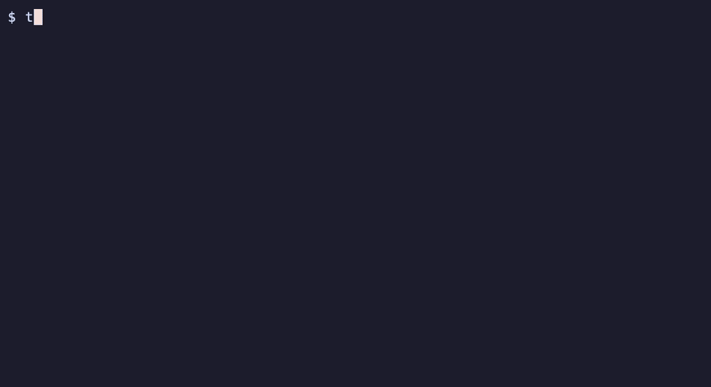
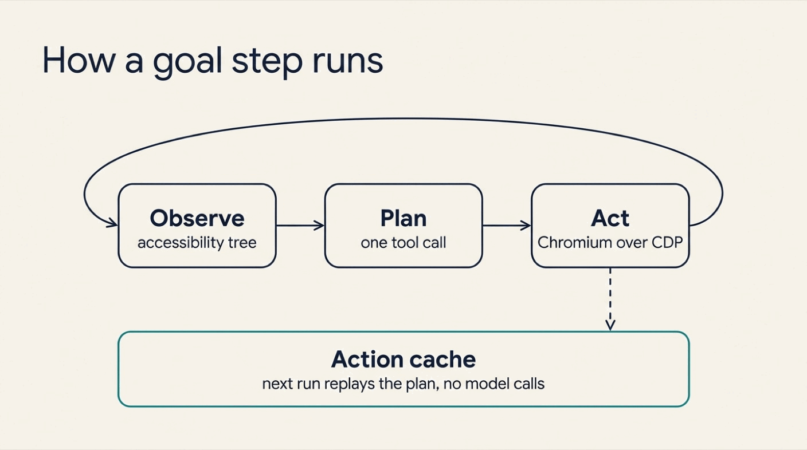
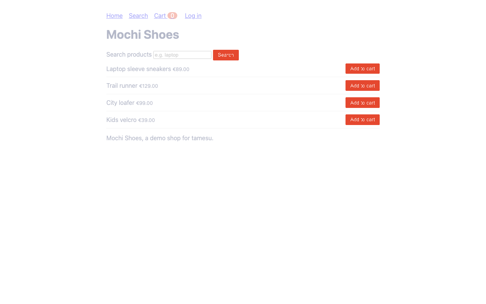

{:.no_toc}
1. this unordered seed list will be replaced by toc as unordered list
{:toc}

## Introduction

End-to-end tests have a bad name, and selectors are the reason. A test clicks `#btn-add-42`. Someone renames the id, and the test fails. Nothing is wrong with the shop. The test was never about the shop. It was about the HTML.

A person does not use a web page that way. A person wants something: "log in", "add the first laptop bag to the cart". They find the button by what it says.

**[tamesu](https://github.com/xavidop/tamesu)** (試す, Japanese for *to try, to test*) lets you write tests that way. It is an open-source CLI written in Go. You describe a step in plain language. A browser agent (a model that reads the page and picks the next action) drives a real Chromium until the step is done. Then tamesu saves what the agent did, so the next run replays it without calling the model.

This is the first of two articles about tamesu. This one covers web apps. The second one, [Testing AI Agents with tamesu](), covers chatbots and other AI agents.



## Why Selector Tests Break

| | Selector scripts | tamesu |
|---|---|---|
| **A step** | A CSS or XPath selector and an action | A sentence that says what the user wants |
| **A renamed id or class** | The test fails | The agent finds the element by its role and name |
| **"Is the user signed in?"** | A text match on one exact string | An `expect` step: a model reads the page and answers yes or no |
| **Cost of AI steps** | Every run pays for every step | Plans are cached, so a stable app replays with no model calls for its goals |
| **Passwords** | In the test code, or in the prompt | Typed by the browser, never sent to the model |
| **Mocks, accessibility, visual checks** | Three more tools | Three more actions in the same YAML file |

You do not have to pick one style. A tamesu test mixes three kinds of steps:

- **`goal`**: a sentence. The agent acts until it is met.
- **`expect`**: a sentence. The model says if the page satisfies it.
- **`action`**: an exact, deterministic step, such as a click on a selector or a check on the URL. No model is involved.

Use a goal where a person would say what they want. Use an action where the test must be exact.

## How a Goal Step Runs



A goal runs in a loop of three stages:

1. **Observe.** tamesu turns the page into an accessibility tree. That is the list of elements a screen reader sees, such as `button "Add to cart"` or `textbox "Search products"`.
2. **Plan.** The browser agent gets the goal and that list. It calls one tool: `click`, `type`, `select`, `scroll`, `navigate`, `wait` or `done`.
3. **Act.** The tool runs in Chromium over CDP (the Chrome DevTools Protocol). The agent gets the new page and plans again.

The loop ends when the agent calls `done`. It also ends after `max_goal_steps` actions (15 by default), and then the step fails.

When a goal succeeds, tamesu saves its actions as a **plan**. The next run replays the plan first. The agent only runs again if the page changed or the replay fails.

## What You Will Build

You will write a suite for Mochi Shoes, the small demo shop in the tamesu repository. It has a login form, a product search and a cart. The suite has five tests:

1. Log in, search and add a product to the cart.
2. A wrong password shows an error.
3. The cart service is down, and the user sees a clear message.
4. The home page has no serious accessibility problems.
5. The home page looks the same as yesterday.

## What You Need

- macOS, Linux or Windows.
- **tamesu 1.20.1** or newer.
- **Go 1.27** or newer, only to run the demo shop.
- Chrome, Chromium or Edge. If none is installed, tamesu downloads Chrome for Testing on first use.
- A **Gemini API key** in `GEMINI_API_KEY`. tamesu calls models through [Genkit](https://genkit.dev), so OpenAI, Anthropic and local models work too.

## Step 1: Install tamesu and Start the Shop

### Install the CLI

```bash
brew install xavidop/tap/tamesu      # macOS
go install github.com/xavidop/tamesu/cmd/tamesu@latest   # any platform
```

Linux packages, a Scoop bucket for Windows and a Docker image with Chromium are on the [install page](https://xavidop.github.io/tamesu/docs/install/).

### Start the demo shop

```bash
git clone https://github.com/xavidop/tamesu
cd tamesu
go run ./examples/webapp
```

The shop now runs on `http://127.0.0.1:18090`. Leave it running and open a second terminal.

## Step 2: Configure the Project

Create a new folder for the tests. Add a file named `tamesu.yaml`:

```yaml
version: 1
suites: ["suites/*.yaml"]

genkit:
  plugins: [googlegenai]
models:
  default: googleai/gemini-3.8-flash
  judge: googleai/gemini-3.8-flash
  browser_agent: googleai/gemini-3.8-flash

defaults: { timeout: 3m, max_goal_steps: 15 }
budgets: { max_cost_usd: 2 }
reporters: [console, junit, html]

secrets:
  GEMINI_API_KEY: env:GEMINI_API_KEY
```

Three things matter here:

- **`models`** says which model does each job. The browser agent drives the page. The judge grades the result at the end.
- **`budgets`** stops the run when the model spend passes the limit.
- **`secrets`** are references, never values. `env:GEMINI_API_KEY` tells tamesu where the key lives. A reference can also point to AWS Secrets Manager, Vault or 1Password.

## Step 3: Write the First Test with Goals

Create `suites/shop.yaml`:


```yaml
suite: shop
tags: [browser]

secrets:
  TEST_PASSWORD: env:TEST_PASSWORD

vars:
  user: marta
  base_url: http://127.0.0.1:18090

targets:
  web:
    type: browser
    url: "{{vars.base_url}}/"
    browser: { engine: chromium, viewport: 1280x800, locale: en-US }
    allowed_domains: ["127.0.0.1"]

tests:
  - name: log in, search and add to cart
    target: web
    steps:
      - action: { navigate: "{{vars.base_url}}/login" }
      - goal: "Log in as {{vars.user}} with the password {{secrets.TEST_PASSWORD}}"
      - expect: "The page shows that marta is signed in"
      - goal: "Search for 'laptop' and add the first result to the cart"
      - expect: "The cart badge shows 1 item"
      - action: { assert_url: { contains: "/cart" } }
      - action: { assert_text: "1 item(s) in your cart" }
    assert:
      - judge: "The steps show the user logging in, finding a product and reaching a cart with one item"
      - metric: { name: goal_steps, lte: 12 }
      - metric: { name: console_errors, lte: 0 }
```


The test reads like a note to a colleague. Two goals do the work. Two `expect` steps check the meaning. Two actions pin the exact URL and text.

The `assert` block runs after the steps:

- **`judge`** asks a model to grade the whole session against one sentence.
- **`metric`** checks numbers that tamesu measured. Here the agent may use 12 actions at most, and the page must log no console errors.

### Check the setup

```bash
export TEST_PASSWORD=correct-horse
tamesu validate
tamesu doctor
```

```text
ok   config: tamesu.yaml (version 1)
ok   suites: 1 file, 1 test
ok   secret GEMINI_API_KEY: env (link 1 of 1)
ok   secret TEST_PASSWORD: env (link 1 of 1)
ok   models: default=googleai/gemini-3.8-flash (GEMINI_API_KEY resolved), judge=googleai/gemini-3.8-flash (GEMINI_API_KEY resolved), browser_agent=googleai/gemini-3.8-flash (GEMINI_API_KEY resolved)
skip speech: no speech models configured (speech.tts / speech.stt); audio mode and sip need them
ok   chromium: Google Chrome 157.0.8103.52 (/Applications/Google Chrome.app/Contents/MacOS/Google Chrome)
skip livekit: no livekit target configured
skip sip: no sip target configured
```

`validate` checks the YAML and reports errors with the file and the line. `doctor` resolves every secret and finds the browser. It never prints a secret value.

### Run it

```bash
tamesu run
```

```text
tamesu run: 1 test, output in .tamesu/runs/2026-11-13T10-29-50
PASS   shop / log in, search and add to cart  45.0s

1 passed, 0 failed, 0 errors in 45.0s · 5 model calls, 6124 tokens, $0.0000 · llm cache: 0 hits, 1 misses
```

The run directory holds a file named `steps.json`. It shows what the agent did for each goal. This is the login goal:


```json
{
  "kind": "goal",
  "text": "Log in as {{vars.user}} with the password {{secrets.TEST_PASSWORD}}",
  "success": true,
  "reason": "Successfully logged in, as indicated by 'Signed in as marta' and the Log out link on the home page.",
  "actions": [
    { "name": "type",  "args": { "element": "textbox \"Username\"", "ref": 5, "text": "marta" } },
    { "name": "type",  "args": { "element": "textbox \"Password\"", "ref": 6, "text": "{{secrets.TEST_PASSWORD}}" } },
    { "name": "click", "args": { "element": "button \"Log in\"", "ref": 7 } }
  ]
}
```


Good to know:

- The agent found the fields by role and name (`textbox "Username"`), not by a selector. A new id or class does not break this test.
- The password never reached the model. The agent typed the placeholder, and the browser replaced it with the value at the moment of typing.
- `allowed_domains` is a fence. The page refuses any navigation outside it.

Here is the recording of that first session. tamesu saves one for every browser test:


## Step 4: Replay with the Action Cache

Run the same command again:

```bash
tamesu run
```

```text
tamesu run: 1 test, output in .tamesu/runs/2026-11-13T10-30-54
PASS   shop / log in, search and add to cart  19.0s

1 passed, 0 failed, 0 errors in 19.0s · 3 model calls, 1510 tokens, $0.0000 · llm cache: 0 hits, 1 misses
```

| | First run | Second run |
|---|---|---|
| Time | 45.0 s | 19.0 s |
| Model calls | 5 | 3 |
| Tokens | 6,124 | 1,510 |
| `cache_hits` metric | 0 | 2 |

Both goals were replayed from the cache. The three calls that remain are the two `expect` steps and the judge.

### What the cache stores

Each plan is a small JSON file under `.tamesu/cache/actions/`:


```json
{
  "goal": "Log in as marta with the password {{secrets.TEST_PASSWORD}}",
  "url_path": "http://127.0.0.1:18090/login",
  "key": "009a68c9257766ca411c55bf",
  "actions": [
    { "name": "type",  "args": { "element": "textbox \"Username\"", "ref": 5, "text": "marta" } },
    { "name": "type",  "args": { "element": "textbox \"Password\"", "ref": 6, "text": "{{secrets.TEST_PASSWORD}}" } },
    { "name": "click", "args": { "element": "button \"Log in\"", "ref": 7 } }
  ]
}
```


The key is built from the goal text, the URL and a fingerprint of the page's interactive elements. If the page changes, the key changes, and the agent plans again. The file holds the secret's placeholder, never its value, so it is safe to commit.

### Two flags to remember

- `tamesu run --replay` is strict. It uses cached plans only. A miss fails the step. Use it in CI.
- `tamesu run --update-cache` ignores the cache, plans again and saves the new plans.

## Step 5: Pin the Exact Parts with Actions

Not every step needs an agent. A wrong password is an exact scenario, so write it with actions. Add this test to the suite:


```yaml
  - name: wrong password shows an error
    target: web
    tags: [auth]
    steps:
      - action: { navigate: "{{vars.base_url}}/login" }
      - action: { fill: { selector: "#user", text: "{{vars.user}}" } }
      - action: { fill: { selector: "#pass", text: "not-the-password" } }
      - action: { click: "button[type=submit]" }
      - expect: "The page shows an error about a wrong username or password and nobody is signed in"
      - action: { assert_url: { contains: "/login" } }
```


The typing and the click are deterministic. Only the `expect` step uses the model, because "nobody is signed in" is about meaning, not about one string.

The full list of actions is short: `navigate`, `click`, `fill`, `press`, `wait`, `screenshot`, `eval_js`, `assert_url`, `assert_text`, `mock`, `a11y` and `visual`.

## Step 6: Mock a Backend That Is Down

What does the user see when the cart service fails? You do not need to break the real service to find out. The `mock` action answers a request before it reaches the network:


```yaml
  - name: cart service is down
    target: web
    tags: [resilience]
    steps:
      - action: { mock: { url: "**/cart/add", method: POST, status: 503, body: "<h1>Cart is unavailable</h1><p>Please try again in a minute.</p>", headers: { Content-Type: "text/html" } } }
      - action: { navigate: "{{vars.base_url}}/" }
      - action: { click: "button[aria-label='Add Trail runner to cart']" }
      - expect: "The page says the cart is unavailable and asks to try again"
    assert:
      - metric: { name: mocked_requests, gte: 1 }
```


`url` is a glob pattern on the full URL. A mock can also add a delay with `delay_ms`, or drop the request with `abort: true`. Mocks for the whole suite go under `browser.mocks` on the target.

Good to know:

- Use a `click` action here, not a goal. A goal such as "Add the Trail runner to the cart" cannot succeed when the cart is down. The agent reports that, and the step fails. When the expected result is an error page, drive with actions and check with `expect`.
- The metric `mocked_requests` proves that the mock was hit. Without it, a typo in the URL pattern would let the test pass for the wrong reason.

## Step 7: Audit Accessibility

The `a11y` action runs [axe-core](https://github.com/dequelabs/axe-core), the standard open-source accessibility engine, on the current page:


```yaml
  - name: home page has no serious accessibility violations
    target: web
    tags: [a11y]
    steps:
      - action: { navigate: "{{vars.base_url}}/" }
      - action: { a11y: { impact: serious } }
```


On the demo shop, this test fails, and it is right:

```text
FAIL   shop / home page has no serious accessibility violations  3.0s
    x step[2] action: 1 accessibility violations at or above serious, want at most 0: label-content-name-mismatch (serious, 4 nodes)
```

The run directory has the details in `a11y-1.json`:

```json
{
  "impact": "serious",
  "violations": [
    {
      "id": "label-content-name-mismatch",
      "impact": "serious",
      "help": "Elements must have their visible text as part of their accessible name",
      "nodes": 4
    }
  ]
}
```

The four nodes are the four "Add to cart" buttons. Each one shows the text "Add to cart", but its `aria-label` says "Add Trail runner to cart". A person who uses voice control says "click Add to cart", and the browser finds no button with that name. The fix is in the shop: the label must contain the visible text, for example "Add to cart: Trail runner".

Two options tune the audit:

- `impact` sets the lowest level that counts: `minor`, `moderate`, `serious` or `critical`.
- `max` allows a number of known violations while you fix them. `include` limits the audit to one part of the page.

## Step 8: Catch Visual Regressions

The `visual` action compares a screenshot with a baseline image:


```yaml
  - name: home page looks the same
    target: web
    tags: [visual]
    steps:
      - action: { navigate: "{{vars.base_url}}/" }
      - action: { visual: { name: home, threshold: 0.01 } }
```


The first run writes the baseline to `suites/visual/home.png` and passes. Commit that file with the suite.

Later runs fail when more than `threshold` of the pixels differ. Here the button colour of the shop changed from navy to red:

```text
FAIL   shop / home page looks the same  2.3s
    x step[2] action: visual home: 1.10% of pixels differ from the baseline, want at most 1.00% (visual/home-diff.png)
```

tamesu writes the difference as an image, with the changed pixels in red:



Good to know:

- Keep `browser.viewport` fixed, so the baseline and the new screenshot have the same size.
- `mask: ["#live-chat", ".date"]` blanks the parts that change on purpose.
- When the new look is the right one, run `tamesu run --update-visual` and commit the new baseline.

## Step 9: Run the Whole Suite

```bash
tamesu run
```

```text
tamesu run: 5 tests, output in .tamesu/runs/2026-11-13T11-06-27
PASS   shop / home page looks the same  3.0s
FAIL   shop / home page has no serious accessibility violations  3.0s
    x step[2] action: 1 accessibility violations at or above serious, want at most 0: label-content-name-mismatch (serious, 4 nodes)
PASS   shop / cart service is down  6.4s
PASS   shop / wrong password shows an error  7.3s
PASS   shop / log in, search and add to cart  19.4s

4 passed, 1 failed, 0 errors in 19.4s · 5 model calls, 2028 tokens, $0.0000 · llm cache: 0 hits, 1 misses
```

Five tests run in parallel in under 20 seconds, with five model calls in total. The exit code is `1`, because one test failed.

Tags select a part of the suite:

```bash
tamesu run --tags a11y,visual
tamesu run --filter "cart"
tamesu run --headed            # show the browser window
```

### What a run leaves behind

Every browser test writes these files to its run directory:

| File | What it holds |
|---|---|
| `screenshots/step-NN.png` | One screenshot per step |
| `recording.webm` or `recording.gif` | A recording of the whole session (`webm` when `ffmpeg` is installed) |
| `steps.json` | Each step, its result, its reason and the agent's actions |
| `trace.har` | Every network request, in the HAR format that browser dev tools open |
| `console.log` | Console errors and uncaught exceptions |
| `report.html` | The whole run as one page, next to `junit.xml` |

A failed test in CI is no longer a mystery. You watch the recording and read the reason.

## Step 10: Run It in CI

tamesu is built for pipelines. It writes `junit.xml`, and its exit codes are fixed:

| Code | Meaning |
|---|---|
| `0` | Every test passed |
| `1` | A test failed |
| `2` | A config or schema error |
| `3` | An infrastructure error, such as a model that cannot be reached |
| `4` | The cost budget was exceeded |

Commit the `.tamesu/cache` folder and the visual baselines. Then a GitHub Actions job looks like this:


```yaml
name: browser tests
on: [push, pull_request]
jobs:
  tamesu:
    runs-on: ubuntu-latest
    steps:
      - uses: actions/checkout@v7
      - uses: actions/setup-go@v7
        with:
          go-version: "1.27"
      - run: go install github.com/xavidop/tamesu/cmd/tamesu@latest
      - run: tamesu validate --strict
      - run: ./scripts/start-shop.sh        # start your app, your way
      - run: tamesu run --replay --out out
        env:
          GEMINI_API_KEY: ${{ secrets.GEMINI_API_KEY }}
          TEST_PASSWORD: ${{ secrets.TEST_PASSWORD }}
      - uses: actions/upload-artifact@v4
        if: always()
        with:
          name: tamesu-run
          path: out
```


With `--replay`, every goal comes from the cached plans. A goal with no plan fails the step instead of calling the agent. The `expect` steps and the judge still call the model, so the job needs the key. In this suite that is three calls and about 1,500 tokens for the checkout test.

The Docker image `ghcr.io/xavidop/tamesu` ships the CLI with Chromium, for runners that have no browser.

## Conclusion

A good browser test says what the user wants, and it fails only when the user would fail. tamesu gets there with three kinds of steps. Goals carry the intent. Actions pin what must be exact. `expect` steps check the meaning.

The action cache is what makes this practical. The agent thinks once per goal. After that, a stable page replays the plan, and the model is only asked the questions that need judgment.

Start small. Take the one flow that breaks most often in your selector suite, write it as two or three goals, and run it next to the old test for a week.

The same YAML, the same assertions and the same reports also test AI agents: chatbots over REST, voice agents on LiveKit and phone lines. That is the second article: [Testing AI Agents with tamesu]().

## Further reading

- [tamesu on GitHub](https://github.com/xavidop/tamesu) and the [documentation](https://xavidop.github.io/tamesu/docs/)
- [The browser target](https://xavidop.github.io/tamesu/docs/targets/browser/): every action, mocks, accessibility and visual options
- [Assertions](https://xavidop.github.io/tamesu/docs/assertions/) and [judges](https://xavidop.github.io/tamesu/docs/judges/)
- [CI](https://xavidop.github.io/tamesu/docs/ci/): GitHub Actions, GitLab, Docker, shards and budgets
- [The demo shop and its suite](https://github.com/xavidop/tamesu/tree/main/examples/browser-shop) in the tamesu repository
- [Testing AI Agents with tamesu](), the second article of this set
- [Production-Ready AI Phone Agents with LiveKit](), where tamesu tests real phone calls
