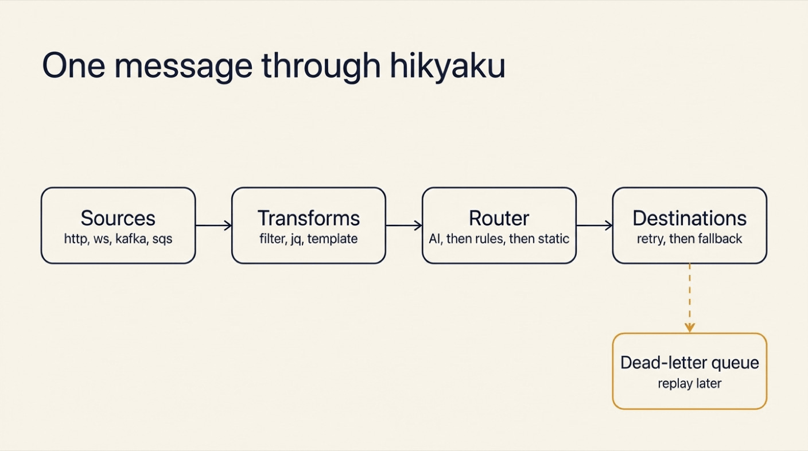
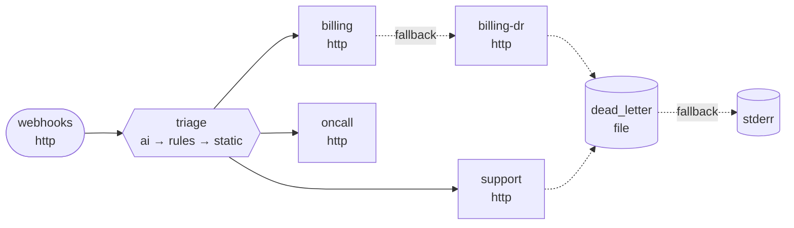

{:.no_toc}
1. this unordered seed list will be replaced by toc as unordered list
{:toc}

## Introduction

Every backend has that one small service. It receives a webhook and forwards it to three other systems. It started as 40 lines. Then one target went down for an hour, and messages were lost. So it got a retry loop. Then a queue. Then a second target needed a different payload. Then someone asked: "can it send billing questions to billing and bugs to support?"

That service is glue, and every team writes it again.

**[hikyaku](https://github.com/xavidop/hikyaku)** (飛脚) is that service, written once. The name comes from the relay couriers of Edo-period Japan. They carried letters from station to station, and they found another way when a road was closed.

hikyaku is a message relay in a single Go binary:

- It **reads messages** from one or more endpoints: a webhook, a WebSocket, a Kafka topic, an SQS queue and more.
- It **delivers them** to one or more others.
- **One YAML file** describes the whole relay.
- **Every step retries and falls back**, so a message is never dropped without a trace.
- An **AI router** can pick the destination of each message, and it tells you how sure it is.


## Why Glue Code Breaks

| | Hand-written glue | hikyaku |
|---|---|---|
| **A target is down** | The message is lost, or a retry loop you wrote at 2 a.m. | Timeout, retry with backoff, circuit breaker, fallback chain |
| **Every target is down** | Gone | A dead-letter queue, and one command to replay it |
| **"Where should this go?"** | A growing `if` chain | Rules, or an AI router with a confidence threshold |
| **A new protocol** | A new service | A new `type:` in the YAML |
| **Testing a routing change** | Deploy and hope | `hikyaku test` and `hikyaku route --dry-run` |
| **The sender's answer** | `200 OK`, always | `200` when delivered, `202` when the message is safe in the dead-letter queue |

## How a Message Travels



Four words cover the whole spec:

- A **source** is where messages come from.
- A **destination** is where they go. Each one has its own timeout, retry policy and **fallback** (the destination to try when this one gives up).
- A **route** connects sources to destinations through a **router**. A router can be static, a list of rules, or AI.
- The **dead-letter queue** (DLQ) is where a message goes when every delivery attempt failed. It is a parking place, not a bin.

A source tells the sender that a message is done only when it is delivered or stored in the DLQ.

## What You Will Build

You will build a support intake relay for a SaaS company:

1. A signed webhook receives customer events.
2. An AI router sends each one to the billing team, the support team, the on-call engineer, or more than one of them.
3. Billing has a backup endpoint. What still fails goes to the DLQ, and you replay it.
4. A test file checks the routing without sending anything.

At the end, you will reuse hikyaku as an LLM proxy that picks a model for each chat request.

## What You Need

- **hikyaku 1.6.1** or newer.
- `curl` and `openssl`.
- For the AI router: a **TypeSafe API key** in `TYPESAFE_API_KEY`. It gives access to `jev`, a decision model.
- For the LLM proxy in step 8: a Gemini key and an Anthropic key.

## Step 1: Install hikyaku and Fan Out a Webhook

### Install

```bash
brew install xavidop/tap/hikyaku                              # macOS
go install github.com/xavidop/hikyaku/cmd/hikyaku@latest      # Go 1.27 or newer
docker run --rm ghcr.io/xavidop/hikyaku:latest version        # Docker
```

Linux packages, a Scoop bucket and a Helm chart are on the [install page](https://xavidop.github.io/hikyaku/docs/install/).

### Scaffold and run

```bash
mkdir relay && cd relay
hikyaku init --template webhook-fanout
hikyaku validate
hikyaku run
```

```text
✓ hikyaku.yaml: valid (1 sources, 2 destinations, 1 routes)
```

The template is one source, two destinations and one route:

```yaml
sources:
  - name: webhooks
    type: http
    mode: listen
    listen: ":8080"
    path: /ingest

destinations:
  - name: console
    type: stdout
    format: body
  - name: archive
    type: file
    path: ./out/archive.ndjson

routes:
  - name: fanout
    from: [webhooks]
    to: [console, archive]
```

### Send a webhook

In a second terminal:

```bash
curl -i http://localhost:8080/ingest \
  -H 'Content-Type: application/json' \
  -d '{"type":"invoice.paid","customer_id":"c-42","amount":129}'
```

```text
HTTP/1.1 200 OK
Content-Type: application/json
Date: Fri, 13 Nov 2026 09:48:10 GMT
Content-Length: 57

{"id":"01M7A4XCXDA6GB265DAMC01RB8","status":"delivered"}
```

The `200` arrives only after both destinations have the message. The first terminal prints the body. The file `out/archive.ndjson` gets the whole **envelope**: the message with its ID, source, headers and attributes.

```json
{"id":"01M7A4XCXDA6GB265DAMC01RB8","source":"webhooks","protocol":"http","subject":"/ingest","headers":{"Accept":["*/*"],"Content-Length":["57"],"Content-Type":["application/json"],"Idempotency-Key":["01M7A4XCXDA6GB265DAMC01RB8"],"User-Agent":["curl/8.7.1"]},"content_type":"application/json","body":{"type":"invoice.paid","customer_id":"c-42","amount":129},"attributes":{"delivery.attempt":1,"http.method":"POST","http.path":"/ingest","remote_addr":"[::1]:61095"},"received_at":"2026-11-13T09:48:10.029716Z"}
```

Note the `Idempotency-Key` header. Every delivery carries the message ID, so a destination can drop a duplicate.

That is a working relay. Stop it with Ctrl-C. Now make it real.

## Step 2: Write the Support Intake Relay

Replace `hikyaku.yaml` with this spec:


```yaml
# yaml-language-server: $schema=https://xavidop.github.io/hikyaku/schema/hikyaku.schema.json
version: 1
name: support-intake

secrets:
  WEBHOOK_SECRET: env:WEBHOOK_SECRET          # a mamori ref, never a value
  TYPESAFE_API_KEY: env:TYPESAFE_API_KEY

genkit:
  systemone:
    servers: [typesafe]

models:
  decision: typesafe/jev-1.13.0               # pin a version: thresholds are tuned per release

sources:
  - name: webhooks
    type: http
    listen: ":8080"
    path: /events
    auth:
      hmac: { header: X-Signature-256, secret: "{{secrets.WEBHOOK_SECRET}}" }

destinations:
  - name: billing
    type: http
    url: http://localhost:9001/billing
    retry: { attempts: 3, backoff: 200ms }
    fallback: [billing-dr]
  - name: billing-dr
    type: http
    url: http://localhost:9002/billing
  - name: support
    type: http
    url: http://localhost:9001/support
    retry: { attempts: 3, backoff: 200ms }
  - name: oncall
    type: http
    url: http://localhost:9001/oncall
    required: false                           # best effort: a failure loses nothing

dead_letter:
  type: file
  path: ./out/dlq.ndjson
  fallback: [stderr]

routes:
  - name: triage
    from: [webhooks]
    router:
      type: ai
      when: has(msg.json.text)                # only free text costs a model call
      instructions: |
        You route customer events for a SaaS company. Pick the team(s) that must see it.
      state: "{{ .bodyText }}"
      state_json: true
      candidates:
        - { name: billing, description: "Money: payments, invoices, charges, refunds, plans and subscription changes" }
        - { name: support, description: "The product misbehaves or the customer needs help: bugs, errors, crashes, how-to questions" }
        - { name: oncall, description: "A live incident: the service is down or failing for many customers right now" }
      multi: true
      min_confidence: 0.9
      input: { redact: ["$.email"] }
      on_low_confidence: [support]
      fallback:
        - type: rules
          rules:
            - { when: 'has(msg.json.type) && msg.json.type.startsWith("invoice.")', to: [billing] }
        - type: static
          to: [support]

server:
  admin: { listen: ":9090" }
```


Read it from top to bottom:

- **`secrets`** are references, never values. `env:WEBHOOK_SECRET` says where the secret lives. A reference can also point to Vault, AWS Secrets Manager and others, through [mamori]().
- **The source** checks an HMAC signature on every request. HMAC is a hash of the body made with a shared secret. A request without a valid signature gets a `401`.
- **`billing`** retries three times, then falls back to `billing-dr`, its backup endpoint.
- **`oncall`** is `required: false`. It is best effort: when it fails, the message still counts as delivered.
- **The route** uses an AI router with three candidates. Each candidate is a destination with a description.

### Stand-in endpoints for the teams

You need something that answers on ports `9001` and `9002`. A second relay does that. It listens on the team URLs and prints what each team receives. Create `teams/hikyaku.yaml`:


```yaml
# The three team endpoints, played by a second relay: it prints what each team receives.
version: 1
name: teams

sources:
  - { name: billing, type: http, listen: ":9001", path: /billing }
  - { name: support, type: http, listen: ":9001", path: /support }
  - { name: oncall, type: http, listen: ":9001", path: /oncall }
  - { name: billing-dr, type: http, listen: ":9002", path: /billing }

destinations:
  - { name: console, type: stdout, format: body }

routes:
  - name: print
    from: [billing, support, oncall, billing-dr]
    transforms:
      - template: '[{{ .source }}] {{ .bodyText }}'
    to: [console]

server:
  admin: { listen: ":9091" }
```


Start it in its own terminal:

```bash
cd teams && hikyaku run
```

### Check the spec

```bash
export WEBHOOK_SECRET=s3cr3t-for-the-demo
export TYPESAFE_API_KEY=...
hikyaku validate
hikyaku doctor
```

```text
✓ spec hikyaku.yaml: 1 sources, 4 destinations, 1 routes
✓ secrets 2 resolved
✓ plugins
✓ destination billing
✓ destination billing-dr
✓ destination oncall
✓ destination support
✓ dead_letter
✓ dead_letter fallback stderr
✓ store default (default)
✓ model typesafe/jev-1.13.0
```

`validate` checks references, fallback cycles and every expression, without starting anything. `doctor` goes further: it resolves the secrets, builds the destinations and checks that the model answers.

## Step 3: Route with a Decision Model

### What a decision model is

A chat model writes text. A **decision model** does not. It answers typed questions about a piece of data, and it gives each answer a **calibrated probability**. Calibrated means the number is honest: when the model says 0.9, it is right about nine times in ten.

That is exactly what routing needs. hikyaku asks one yes/no question per candidate: "should *billing* receive this?" A candidate is chosen when its probability reaches `min_confidence`. With `multi: true`, more than one team can get the message.

The model here is `jev`, served by TypeSafe through the [System One plugin of Genkit Go](https://genkit.dev/docs/go/integrations/system-one/). I used the same model to route work in [Genkit Flows on Kubernetes with senro and jev]().

### Ask the router, without delivering

Save a message as `msg.json`:

```json
{"type":"ticket.created","customer_id":"cus_42","email":"ada@example.com","text":"I was charged twice for my invoice this month and want a refund."}
```

Then ask the router where it would send it:

```bash
hikyaku route --dry-run --source webhooks --data @msg.json
```

```text
route triage: ai (typesafe/jev-1.13.0) → billing, support
    * billing              p=0.99
    * support              p=0.90
      oncall               p=0.06
    reason: chosen: billing, support
    plan: billing → billing-dr
    plan: support
```

The output shows the probability of every candidate, the destinations chosen, and the fallback plan of each one. Nothing was sent.

The model is sure about billing (0.99). It is also at 0.90 for support, right on the threshold. A double charge is a billing matter, so this message should not reach support. The next step fixes that with data, not with a guess.

Good to know:

- `input.redact` removes the e-mail address before the model sees the message. The destinations still get the full message.
- The message is data for the model, never instructions. The router can only choose among the candidates in the spec.

## Step 4: Tune the Threshold with Labeled Cases

Write down what you expect. Create `cases.yaml`:

```yaml
cases:
  - name: double charge
    data: { text: "I was charged twice for my invoice and want a refund." }
    expect: [billing]
  - name: plan change
    data: { text: "Please change my subscription to the yearly plan and send the invoice." }
    expect: [billing]
  - name: crash
    data: { text: "The app crashes with an error every time I open the dashboard." }
    expect: [support]
  - name: how-to
    data: { text: "How do I invite a teammate? Is there a how-to guide?" }
    expect: [support]
  - name: outage
    data: { text: "Total outage: every request fails with 503 errors since 10:00." }
    expect: [support, oncall]
  - name: double charge, longer
    data: { text: "I was charged twice for my invoice this month and want a refund." }
    expect: [billing]
```

Then score the router on those cases:

```bash
hikyaku ai test --route triage --cases cases.yaml
```

```text
route triage: 6 cases
accuracy  83.3% (5/6)
latency   p50 193ms  p95 260ms  max 260ms

per destination   precision  recall
  billing              1.00    1.00
  oncall               1.00    1.00
  support              0.75    1.00

confusion (rows: expected, columns: got)
                      billing billing+s… oncall+su…    support
  billing                   2          1          0          0
  oncall+support            0          0          1          0
  support                   0          0          0          2

calibration (confidence → accuracy) ECE 0.122
  0.9-1.0  n=6   confidence 0.96  accuracy 0.83

misses
  ✗ double charge: expected billing, got billing, support (ai, p=0.90)
```

The report names the problem. Recall is perfect: every team gets what it must see. But precision for support is 0.75, because one double charge also went there, at exactly 0.90.

Raise the threshold in `hikyaku.yaml`:

```yaml
      min_confidence: 0.95
```

And run the same command again:

```text
route triage: 6 cases
accuracy  100.0% (6/6)
latency   p50 167ms  p95 240ms  max 240ms

per destination   precision  recall
  billing              1.00    1.00
  oncall               1.00    1.00
  support              1.00    1.00

confusion (rows: expected, columns: got)
                      billing oncall+su…    support
  billing                   3          0          0
  oncall+support            0          1          0
  support                   0          0          2

calibration (confidence → accuracy) ECE 0.028
  0.9-1.0  n=6   confidence 0.97  accuracy 1.00
```

Six of six, and a decision takes about 170 ms. The outage still reaches both support and on-call, as it should.

Good to know:

- **ECE** is the expected calibration error: the gap between how sure the model is and how often it is right. Lower is better.
- Pin the model version (`jev-1.13.0`). Calibration changes between releases, so a threshold belongs to one version. `hikyaku lint` warns about an unpinned model.
- `--min-accuracy 0.9` makes the command exit with `1` below that accuracy. Put it in CI.
- Six cases are a start. Add a case every time the router surprises you.

## Step 5: Run It and Send Real Messages

Start the relay:

```bash
hikyaku run
```

The webhook wants a signature, so write a small helper, `send.sh`:

```bash
#!/bin/sh
# send.sh '<json>': sign the body with WEBHOOK_SECRET and post it to the relay
sig=$(printf '%s' "$1" | openssl dgst -sha256 -hmac "$WEBHOOK_SECRET" -hex | awk '{print $NF}')
curl -s -m 60 -w ' (HTTP %{http_code})\n' localhost:8080/events \
  -H 'Content-Type: application/json' -H "X-Signature-256: $sig" -d "$1"
```

### A free-text message

```bash
./send.sh '{"customer_id":"cus_7","text":"Total outage: every request fails with 503 errors since 10:00."}'
./send.sh '{"customer_id":"cus_9","text":"How do I invite a teammate? Is there a how-to guide?"}'
```

```text
{"id":"01M7A6GEHCS0EDBNYCTDZN0K1S","status":"delivered"}
 (HTTP 200)
{"id":"01M7A6GEXXP0XD62FZRKVEJZ6T","status":"delivered"}
 (HTTP 200)
```

The teams terminal shows who got what:

```text
[oncall] {"customer_id":"cus_7","text":"Total outage: every request fails with 503 errors since 10:00."}
[support] {"customer_id":"cus_7","text":"Total outage: every request fails with 503 errors since 10:00."}
[support] {"customer_id":"cus_9","text":"How do I invite a teammate? Is there a how-to guide?"}
```

The outage went to two teams. The how-to question went to one.

### A typed event costs no model call

```bash
./send.sh '{"type":"invoice.paid","customer_id":"cus_42","amount":129}'
```

```text
{"id":"01M7A6GF4ENM3FDPZB1SHD3G9S","status":"delivered"}
 (HTTP 200)
```

The teams terminal:

```text
[billing] {"type":"invoice.paid","customer_id":"cus_42","amount":129}
```

This event has no `text` field, so the router's `when: has(msg.json.text)` is false. The AI step is skipped, and the next router in the chain, the rules, sends it to billing. A dry run of the same event says so:

```text
route triage: rules → billing
    fell back from ai: skipped (when is false)
    plan: billing → billing-dr
```

The router chain is **AI, then rules, then static**. The same chain protects you when the model is down or over its budget: the rules take over, and the static route catches the rest.

### An unsigned request is refused

```bash
curl -s -i localhost:8080/events -H 'Content-Type: application/json' -d @msg.json
```

```text
HTTP/1.1 401 Unauthorized
Content-Type: application/json
Www-Authenticate: Bearer
Date: Fri, 13 Nov 2026 10:16:03 GMT
Content-Length: 34

{"id":"","status":"unauthorized"}
```

### Watch the numbers

The admin API on `:9090` serves Prometheus metrics:

```bash
curl -s localhost:9090/metrics | grep -E "^hikyaku_(router|ai_decisions)"
```

```text
hikyaku_ai_decisions_total{outcome="chosen",route="triage"} 2
hikyaku_router_fallback_total{route="triage",to="rules"} 1
hikyaku_router_skipped_total{route="triage",router="ai"} 1
```

Two messages needed a decision. One skipped the model and went through the rules.

## Step 6: Break It on Purpose

A relay earns its place on the bad days. Make one.

### Every billing endpoint is down

Stop the teams relay with Ctrl-C. Both `billing` and `billing-dr` are now unreachable. Send a billing message:

```bash
./send.sh '{"customer_id":"cus_42","text":"I was charged twice for my invoice and want a refund."}'
```

```text
{"id":"01M7A6GG95TT62N5XR4RDETANW","status":"dead_lettered"}
 (HTTP 202)
```

The answer came after 2.1 seconds, and it is honest. It is not a `200`, because the message was not delivered. It is a `202`: the message is safe in the dead-letter queue. The relay's log tells the story:

```text
{"time":"2026-11-13T11:16:05.144194+01:00","level":"INFO","msg":"destination fallback","from":"billing","to":"billing-dr","reason":"exhausted"}
{"time":"2026-11-13T11:16:06.719256+01:00","level":"WARN","msg":"dead-lettered","id":"01M7A6GG95TT62N5XR4RDETANW","route":"triage","destination":"billing","reason":"delivery","hop":"dead_letter","err":"destination billing-dr: Post \"http://localhost:9002/billing\": dial tcp [::1]:9002: connect: connection refused"}
```

### Read the dead letter

```bash
hikyaku dlq list
```

```text
01M7A6GG95TT62N5XR4RDETANW  2026-11-13 11:16:06  billing          delivery   ×8  destination billing-dr: Post "http://localhost:9002/billing": dial tcp [::1]:900…
1 dead letter(s)
```

Eight attempts in total. `hikyaku dlq inspect <id>` prints the whole story of the message. This is part of it:

```json
{
  "ai.decision": {
    "answers": [
      { "candidate": "billing", "chosen": true, "p": 0.99 },
      { "candidate": "support", "p": 0.87 },
      { "candidate": "oncall", "p": 0.07 }
    ],
    "model": "typesafe/jev-1.13.0",
    "reason": "chosen: billing"
  },
  "dlq": {
    "attempts": 8,
    "destination": "billing",
    "hops": [
      { "destination": "billing", "attempts": 3, "outcome": "exhausted",
        "error": "Post \"http://localhost:9001/billing\": dial tcp [::1]:9001: connect: connection refused" },
      { "destination": "billing-dr", "attempts": 5, "outcome": "exhausted",
        "error": "Post \"http://localhost:9002/billing\": dial tcp [::1]:9002: connect: connection refused" }
    ],
    "reason": "delivery",
    "route": "triage"
  }
}
```

The dead letter keeps the AI decision and every hop: three attempts on `billing`, five on `billing-dr`. Six months from now, you can still answer "why did this message go there, and why did it fail?"

### Replay it

Start the teams relay again. Then:

```bash
hikyaku dlq replay --dry-run
hikyaku dlq replay
```

```text
would deliver 01M7A6GG95TT62N5XR4RDETANW to billing
✓ billing: delivered after 1 attempt(s) (status 200)
    · billing ×1 ok
```

The teams terminal prints the message, one outage later:

```text
[billing] {"customer_id":"cus_42","text":"I was charged twice for my invoice and want a refund."}
```

Good to know:

- A replay keeps the original message ID as its idempotency key, so a destination that already has the message can drop the duplicate.
- `hikyaku dlq` reads the DLQ file directly. It works without a running relay.
- The entry stays in the DLQ file after a replay. Use `--since 1h` or `--id` to choose what to replay.

### Inject faults before production does

You do not have to wait for an outage. `hikyaku chaos` wraps a destination with a fault injector and pushes messages through its real retry and fallback path:

```bash
hikyaku chaos --destination billing --fail 50% --count 100 --data @msg.json
```

```text
chaos 100 messages to billing, 117 attempts (1.2 per message)
  delivered by billing     17
  delivered by fallback billing-dr  83
  dead-lettered          0
  lost                   0
  latency p50 0s  p95 188ms
```

Half of the attempts on `billing` failed. No message was lost, and none was dead-lettered. Most of them went to the backup, with only 1.2 attempts per message. That is the **circuit breaker** at work. After 20 requests with half of them failing, hikyaku stops calling the sick endpoint for 30 seconds and sends traffic straight to the fallback. The command exits with `1` if a message is lost.

## Step 7: Test the Relay in CI

A routing change is a code change. `hikyaku test` checks what the spec does with the messages you give it. Nothing is sent: every destination is replaced by a stand-in. The filters, the routers, the retries and the fallbacks are the real ones.

Create `hikyaku.test.yaml`:

```yaml
# hikyaku test: nothing is sent, every destination is a stand-in.
tests:
  - name: a typed invoice event goes to billing without a model call
    source: webhooks
    body: { type: invoice.paid, customer_id: cus_42, amount: 129 }
    expect:
      status: delivered
      to: [billing]
      routes:
        triage: { router: rules }

  - name: billing down fails over to its DR endpoint
    source: webhooks
    body: { type: invoice.paid, id: evt_2 }
    down: [billing]
    expect:
      status: delivered
      delivered:
        billing: { via: billing-dr, contains: { id: evt_2 } }

  - name: billing and its DR both down dead-letters the event
    source: webhooks
    body: { type: invoice.paid, id: evt_3 }
    down: [billing, billing-dr]
    expect:
      status: dead_lettered
      failed: [billing]

  - name: an outage reaches support even when on-call is down
    source: webhooks
    body: { text: "Total outage: every request fails with 503 errors." }
    decide: { triage: [support, oncall] }      # answer for the router: no model call
    down: [oncall]
    expect:
      status: delivered
      to: [support, oncall]
      failed: [oncall]
```

```bash
hikyaku test
```

```text
✓ a typed invoice event goes to billing without a model call (1ms)
✓ billing down fails over to its DR endpoint (0s)
✓ billing and its DR both down dead-letters the event (0s)
✓ an outage reaches support even when on-call is down (0s)
✓ 4 test(s) passed
```

`down:` makes a destination unreachable for one test. `decide:` answers in place of the route's router, so the last test checks delivery without calling the model.

Good to know:

- `decide` replaces the whole router chain of the route, rules included. A test with `decide` checks delivery. A test without it checks routing.
- A test without `decide` builds the real router, so the job needs the secrets that the spec declares, even when no model call is made.
- Score the model's own answers with `hikyaku ai test`, as in step 4.

Two more commands belong in the same pipeline. `hikyaku lint` warns about risky specs:

```text
! route "triage".router.fallback_models: a single model: when it is down the router fallback serves every message; add a fallback model (such as a local ollama-decisions/clef)
! destination "billing-dr".fallback: required and without a fallback: when it fails, its messages go to the DLQ
! destination "support".fallback: required and without a fallback: when it fails, its messages go to the DLQ
! server.admin.token: unset: /reload, /debug, /v1/tail, /v1/feedback and /v1/history answer loopback clients only
4 warning(s)
```

And `hikyaku graph --dead-letter` draws the spec as a Mermaid flowchart, which GitHub renders in a pull request:





## Step 8: Bonus, an LLM Proxy with the Same Tool

A chat request is also a message. A model is also a destination. So the same relay, with a different spec, is an **LLM proxy**: one OpenAI-compatible endpoint in front of several model providers.

Clients ask for `fast`, `smart` or `auto`. With `auto`, the decision model picks the model by how hard the request is. Create a new folder with this `hikyaku.yaml`:


```yaml
# yaml-language-server: $schema=https://xavidop.github.io/hikyaku/schema/hikyaku.schema.json
version: 1
name: llm-proxy

secrets:
  PROXY_KEY: env:PROXY_KEY
  GEMINI_API_KEY: env:GEMINI_API_KEY
  ANTHROPIC_API_KEY: env:ANTHROPIC_API_KEY
  TYPESAFE_API_KEY: env:TYPESAFE_API_KEY

genkit:
  plugins: [systemone, googlegenai, anthropic]

sources:
  - name: api
    type: openai
    listen: ":8080"
    models: [auto, fast, smart]
    auth: { bearer: { tokens: ["{{secrets.PROXY_KEY}}"] } }

defaults:
  timeout: 60s
  retry: { attempts: 2, backoff: 500ms }

destinations:
  - { name: fast, type: model, model: googleai/gemini-3.8-flash }
  - { name: smart, type: model, model: anthropic/claude-sonnet-5-5, fallback: [fast] }

routes:
  - name: chat
    from: [api]
    router:
      type: rules
      rules:
        - { when: 'msg.json.model == "fast"', to: [fast] }
        - { when: 'msg.json.model == "smart"', to: [smart] }
      fallback:
        - type: ai
          when: msg.json.model == "auto"       # only "auto" pays for a decision
          model: typesafe/jev-1.13.0
          instructions: Pick the model for this chat request.
          state: "{{ .json.messages }}"
          candidates:
            - { name: fast, description: "A short or simple request: a lookup, a rewrite, small talk." }
            - { name: smart, description: "A hard request: multi-step reasoning, code, analysis." }
          min_confidence: 0.6
          on_low_confidence: [smart]
          fallback:
            - { type: static, to: [fast] }

server:
  admin: { listen: ":9090" }
```


```bash
export PROXY_KEY=local-dev-key GEMINI_API_KEY=... ANTHROPIC_API_KEY=... TYPESAFE_API_KEY=...
hikyaku doctor && hikyaku run
```

Call it like the OpenAI API:

```bash
curl -s localhost:8080/v1/chat/completions \
  -H 'Authorization: Bearer local-dev-key' -H 'Content-Type: application/json' \
  -d '{"model":"fast","messages":[{"role":"user","content":"Say hi in five words."}]}'
```

```json
{"id":"chatcmpl-01M7A5NPX91XMA3QE3HANMVQTD","object":"chat.completion","created":1794564086,"model":"googleai/gemini-3.8-flash","choices":[{"index":0,"message":{"role":"assistant","content":"Hi there, how are you?"},"finish_reason":"stop"}],"usage":{"prompt_tokens":7,"completion_tokens":7,"total_tokens":466}}
```

Now let the proxy choose. The `model` field of each answer shows who served it:

| Request with `"model": "auto"` | Answered by |
|---|---|
| "What is the capital of France?" | `googleai/gemini-3.8-flash` |
| "Write a Go function that merges two sorted linked lists and prove its time complexity step by step." | `anthropic/claude-sonnet-5-5` |

The easy question went to the cheap, fast model. The hard one went to the stronger model. A request without the bearer key gets a `401`.

Everything from the first seven steps still applies. `smart` has `fallback: [fast]`, so when Anthropic has a bad day, Gemini answers. Retries, the circuit breaker and the metrics work the same way. Any OpenAI SDK can use the proxy: set its base URL to `http://localhost:8080/v1`.

The gateway has its own guide, with streaming, function calling, labeled cases for the model choice and a failover test: [Build an LLM Gateway with hikyaku]().

## What Else Is in the Box

This guide used HTTP on both sides. The relay speaks many more protocols, and each one is a `type:` in the same spec:

| Protocol | As a source | As a destination |
|---|---|---|
| `http` / `https` | listen, poll | yes |
| `ws` / `wss`, `sse`, `grpc` | listen, subscribe | yes |
| `tcp` / `udp` | listen | yes |
| `kafka`, `nats` / `jetstream`, `mqtt`, `amqp` (RabbitMQ) | subscribe | yes |
| `redis` (Streams, Pub/Sub) | subscribe | yes |
| `sqs` / `sns` / `eventbridge`, `pubsub`, `servicebus` / `eventhubs` | subscribe | yes |
| `s3` / `gcs` | poll | yes |
| `stdin` / `stdout` / `stderr` / `file` | yes | yes |

The [documentation](https://xavidop.github.io/hikyaku/docs/) also covers:

- **Transforms**: filter with CEL, reshape with jq, render a template, validate against a JSON Schema.
- **History-aware routing**: a follow-up from the same customer goes where the last message went.
- **Deploys**: a Docker image and a Helm chart, a disk buffer that survives a crash, hot reload, and OpenTelemetry traces.
- **Your own types**: add a source or a destination in Go, in your own build or as a plugin.

## Conclusion

Glue code looks small, and it hides the hard parts of distributed systems: retries, backpressure, failover, and the question "where did that message go?" hikyaku puts those parts in one binary and one YAML file. The relay answers `200` only when the message arrived, and `202` only when it is safe.

The AI router is the new piece. It is not a chat model guessing in free text. It is a decision model that answers one question per destination with a probability you can measure. You tune it with labeled cases, and you keep rules behind it for the day the model is down.

Start with the boring part. Put hikyaku in front of one webhook, with one fallback and a dead-letter queue. Add the AI router later, in shadow mode, next to the rules you already trust.

## Further reading

- [hikyaku on GitHub](https://github.com/xavidop/hikyaku) and the [documentation](https://xavidop.github.io/hikyaku/docs/)
- [Quick start](https://xavidop.github.io/hikyaku/docs/quickstart/) and [concepts](https://xavidop.github.io/hikyaku/docs/concepts/)
- [Routing and the AI router](https://xavidop.github.io/hikyaku/docs/routing/): engines, thresholds, shadow mode, cache and budget
- [Retries and fallbacks](https://xavidop.github.io/hikyaku/docs/resilience/) and [the LLM proxy](https://xavidop.github.io/hikyaku/docs/llm-proxy/)
- [The examples](https://github.com/xavidop/hikyaku/tree/main/examples): webhook fan-out, AI triage, a Kafka bridge, an LLM proxy and two plugins
- [Build an LLM Gateway with hikyaku](), the second hikyaku article
- [Genkit Flows on Kubernetes with senro and jev](), another use of the jev decision model
- [Testing AI Agents with tamesu](), the testing tool from the same family
