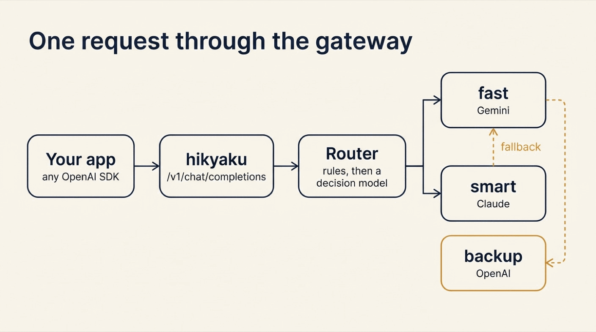
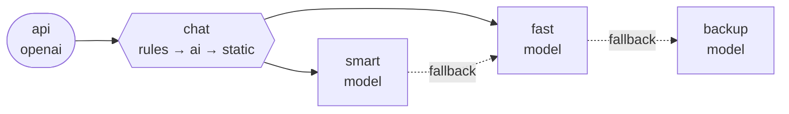

{:.no_toc}
1. this unordered seed list will be replaced by toc as unordered list
{:toc}

## Introduction

Look at how your app calls a model today. There is an SDK, an API key and a model name, all in the code. That works until one of three things happens:

- The provider has a bad hour, and your feature is down with it.
- A cheaper or better model ships, and moving to it is a code change in every service.
- You pay for the strongest model on every request, including "say hi".

An **LLM gateway** fixes this. It is one endpoint that sits between your apps and the model providers. The apps call the gateway. The gateway picks the model, retries, and fails over to another provider.

**[hikyaku](https://github.com/xavidop/hikyaku)** (飛脚) is an open-source message relay written in Go. Its [launch article]() builds a webhook relay with AI routing. This article uses the same binary for a different job. A chat request is a message. A model is a destination. So the relay you already know is also a gateway.

## Why Calling Providers Directly Hurts

| | Each app calls a provider | Apps call a hikyaku gateway |
|---|---|---|
| **Model choice** | A model name in the code of every service | `fast`, `smart` or `auto`, mapped in one YAML file |
| **A provider is down** | Your feature is down | The request falls back to another provider |
| **Easy and hard requests** | The same expensive model for both | A decision model sends each one to the right model |
| **Provider keys** | In every service | Only in the gateway; apps hold one gateway key |
| **A new model** | A deploy per service | One line in the spec, and a reload |
| **Token usage** | A dashboard per provider | One Prometheus metric, per destination |

## How a Request Travels



Three parts of the spec do the work:

- An **`openai` source** is the endpoint. It speaks the OpenAI HTTP API, so any OpenAI SDK can call it.
- **`model` destinations** are the models. Each one runs the request on one model and answers in the OpenAI format.
- A **route** picks a destination for each request. Rules handle the names `fast` and `smart`. For `auto`, a decision model picks.

Every model destination has the delivery features of any hikyaku destination: a timeout, retries, a circuit breaker and a fallback.

## What You Will Build

A gateway over three providers:

1. `fast` is Gemini. `smart` is Claude. `backup` is an OpenAI model that only serves when the others fail.
2. `auto` lets a decision model choose between `fast` and `smart` for each request.
3. Streaming, function calling and JSON output pass through.
4. When Claude fails, Gemini answers the same request.

## What You Need

- **hikyaku 1.6.1** or newer: `brew install xavidop/tap/hikyaku`, or `go install github.com/xavidop/hikyaku/cmd/hikyaku@latest`.
- `curl`.
- API keys for the providers you want to use. This guide uses `GEMINI_API_KEY`, `ANTHROPIC_API_KEY` and `OPENAI_API_KEY`.
- A **TypeSafe API key** in `TYPESAFE_API_KEY`, for the decision model behind `auto`.

## Step 1: Write the Gateway Spec

Create a folder and add this `hikyaku.yaml`:


```yaml
# yaml-language-server: $schema=https://xavidop.github.io/hikyaku/schema/hikyaku.schema.json
version: 1
name: llm-gateway

secrets:
  PROXY_KEY: env:PROXY_KEY                    # the key your apps send to the gateway
  GEMINI_API_KEY: env:GEMINI_API_KEY          # the provider keys stay here
  ANTHROPIC_API_KEY: env:ANTHROPIC_API_KEY
  OPENAI_API_KEY: env:OPENAI_API_KEY
  TYPESAFE_API_KEY: env:TYPESAFE_API_KEY

genkit:
  plugins: [systemone, googlegenai, anthropic, openai]

sources:
  - name: api
    type: openai
    listen: ":8080"
    models: [auto, fast, smart]               # what GET /v1/models lists
    auth: { bearer: { tokens: ["{{secrets.PROXY_KEY}}"] } }

defaults:
  timeout: 60s
  retry: { attempts: 2, backoff: 500ms }

destinations:
  - name: fast
    type: model
    model: googleai/gemini-3.8-flash
    fallback: [backup]
  - name: smart
    type: model
    model: anthropic/claude-sonnet-5-5
    fallback: [fast]
  - name: backup
    type: model
    model: openai/gpt-5.4-mini

routes:
  - name: chat
    from: [api]
    router:
      type: rules
      rules:
        - { when: 'msg.json.model == "fast"', to: [fast] }
        - { when: 'msg.json.model == "smart"', to: [smart] }
      fallback:
        - type: ai
          when: msg.json.model == "auto"      # only "auto" pays for a decision
          model: typesafe/jev-1.13.0
          instructions: Pick the model for this chat request.
          state: "{{ .json.messages }}"
          candidates:
            - { name: fast, description: "A short or simple request: a greeting, a lookup, a rewrite, small talk" }
            - { name: smart, description: "A hard request: multi-step reasoning, math, code, analysis" }
          min_confidence: 0.6
          on_low_confidence: [smart]
          fallback:
            - { type: static, to: [fast] }

server:
  admin: { listen: ":9090" }
```


Read it from top to bottom:

- **`secrets`** are references, not values. The provider keys stay on the gateway. `PROXY_KEY` is the one key your apps send.
- **`genkit.plugins`** loads the model providers. hikyaku calls models through [Genkit Go](https://genkit.dev).
- **The source** lists the model names your clients may ask for. These are your names, not the providers' names.
- **The destinations** map each name to a real model. `smart` falls back to `fast`. `fast` falls back to `backup`.
- **The route** has a chain of routers: rules first, then the AI router, then a static catch-all.

### Check it

```bash
export PROXY_KEY=local-dev-key
hikyaku validate
hikyaku doctor
```

```text
✓ spec hikyaku.yaml: 1 sources, 3 destinations, 1 routes
✓ secrets 5 resolved
✓ plugins
✓ destination backup
✓ destination fast
✓ destination smart
✓ dead_letter
✓ store default (default)
✓ model anthropic/claude-sonnet-5-5
✓ model googleai/gemini-3.8-flash
✓ model openai/gpt-5.4-mini
✓ model typesafe/jev-1.13.0
```

`doctor` resolves every secret and checks that each model answers. Fix what it reports before you go on.

`hikyaku graph` draws the spec. The dashed lines are the fallbacks:





Start the gateway:

```bash
hikyaku run
```

## Step 2: Call It Like the OpenAI API

### List the models

```bash
curl -s localhost:8080/v1/models -H 'Authorization: Bearer local-dev-key'
```

```json
{"data":[{"id":"auto","object":"model","created":0,"owned_by":"hikyaku"},{"id":"fast","object":"model","created":0,"owned_by":"hikyaku"},{"id":"smart","object":"model","created":0,"owned_by":"hikyaku"}],"object":"list"}
```

### Ask for a model by name

```bash
curl -s localhost:8080/v1/chat/completions \
  -H 'Authorization: Bearer local-dev-key' -H 'Content-Type: application/json' \
  -d '{"model":"fast","messages":[{"role":"user","content":"Say hi in five words."}]}'
```

```json
{"id":"chatcmpl-01M7A7SNT3ZMV41Y8T56EQ9G9W","object":"chat.completion","created":1794566313,"model":"googleai/gemini-3.8-flash","choices":[{"index":0,"message":{"role":"assistant","content":"Hi! Hope you are well."},"finish_reason":"stop"}],"usage":{"prompt_tokens":7,"completion_tokens":7,"total_tokens":408}}
```

The answer has the shape of an OpenAI chat completion. The `model` field tells you which real model served it. Now `smart`:

```bash
curl -s localhost:8080/v1/chat/completions \
  -H 'Authorization: Bearer local-dev-key' -H 'Content-Type: application/json' \
  -d '{"model":"smart","max_tokens":60,"messages":[{"role":"user","content":"In one sentence, why is a mutex needed around a shared map in Go?"}]}'
```

```json
{"id":"chatcmpl-01M7A7STYGDEXJFNTPZHQVH3JS","object":"chat.completion","created":1794566319,"model":"anthropic/claude-sonnet-5-5","choices":[{"index":0,"message":{"role":"assistant","content":"A mutex is needed because Go's built-in maps aren't safe for concurrent use, so simultaneous reads and writes (or multiple writes) from different goroutines cause data races that can cor"},"finish_reason":"length"}],"usage":{"prompt_tokens":31,"completion_tokens":60,"total_tokens":91}}
```

Same endpoint, same request shape, a different provider. The answer stops at 60 tokens, as the request asked.

### Use an SDK

Because the endpoint speaks the OpenAI API, an OpenAI SDK only needs a new base URL and the gateway key:

```python
from openai import OpenAI

client = OpenAI(base_url="http://localhost:8080/v1", api_key="local-dev-key")
```

Good to know:

- A request without the key gets a `401` in OpenAI's error format: `{"error":{"code":"invalid_api_key","message":"unauthorized: missing or wrong bearer token","param":null,"type":"invalid_request_error"}}`.
- The caller's `Authorization` header is never copied into the message. A provider never sees your gateway key, and a client never sees a provider key.

## Step 3: Let a Decision Model Pick

Most requests are easy. A few are hard. With `"model": "auto"`, the gateway decides.

The AI router does not use a chat model for this. It uses a **decision model**: a model that answers typed questions about a piece of data and gives each answer a calibrated probability. Here the question is "which of these two models should take this request?" The model is `jev`, served by TypeSafe through the System One plugin of Genkit.

### See the decision before you spend a token

Save two requests:

```bash
echo '{"model":"auto","messages":[{"role":"user","content":"What is the capital of France?"}]}' > easy.json
echo '{"model":"auto","max_tokens":300,"messages":[{"role":"user","content":"Write a Go function that merges two sorted linked lists and prove its time complexity step by step."}]}' > hard.json
```

`hikyaku route --dry-run` shows what the router would do, without calling any chat model:

```bash
hikyaku route --dry-run --source api --data @easy.json
hikyaku route --dry-run --source api --data @hard.json
```

```text
route chat: ai (typesafe/jev-1.13.0) → fast
    fell back from rules: no rule matched
    * fast                 p=1.00
      smart                p=0.00
    reason: fast (p=1.00, margin 1.00)
    plan: fast → backup
route chat: ai (typesafe/jev-1.13.0) → smart
    fell back from rules: no rule matched
      fast                 p=0.00
    * smart                p=1.00
    reason: smart (p=1.00, margin 1.00)
    plan: smart → fast → backup
```

The rules did not match `auto`, so the AI router decided. The last line of each block is the delivery plan, fallbacks included.

### Send them for real

```bash
curl -s localhost:8080/v1/chat/completions \
  -H 'Authorization: Bearer local-dev-key' -H 'Content-Type: application/json' -d @easy.json
```

```json
{"id":"chatcmpl-01M7A7SWTN5XQ304FJYZDKWZ3T","object":"chat.completion","created":1794566321,"model":"googleai/gemini-3.8-flash","choices":[{"index":0,"message":{"role":"assistant","content":"The capital of France is **Paris**."},"finish_reason":"stop"}],"usage":{"prompt_tokens":8,"completion_tokens":8,"total_tokens":69}}
```

The same call with `hard.json` comes back from `anthropic/claude-sonnet-5-5`, with 37 prompt tokens and 300 completion tokens.

| Request with `"model": "auto"` | Answered by |
|---|---|
| "What is the capital of France?" | `googleai/gemini-3.8-flash` |
| "Write a Go function that merges two sorted linked lists and prove its time complexity step by step." | `anthropic/claude-sonnet-5-5` |

Good to know:

- Only `auto` pays for a decision. The AI router has `when: msg.json.model == "auto"`, so `fast` and `smart` never reach it.
- When the decision model is unsure, `on_low_confidence: [smart]` sends the request to the stronger model. A wrong guess costs money, not quality.
- A model name that no rule knows, such as `gpt-9`, skips the AI router and lands on the static catch-all. In this spec that is `fast`.

## Step 4: Score the Router on Labeled Cases

"It picked right twice" is not a test. Write down what you expect in `cases.yaml`:

```yaml
cases:
  - name: greeting
    data: { model: auto, messages: [{ role: user, content: "Hi there, how are you today?" }] }
    expect: [fast]
  - name: lookup
    data: { model: auto, messages: [{ role: user, content: "What is the capital of France?" }] }
    expect: [fast]
  - name: rewrite
    data: { model: auto, messages: [{ role: user, content: "Rewrite this sentence in a friendlier tone: send me the report now." }] }
    expect: [fast]
  - name: code
    data: { model: auto, messages: [{ role: user, content: "Write a Go function that merges two sorted linked lists and prove its time complexity step by step." }] }
    expect: [smart]
  - name: math
    data: { model: auto, messages: [{ role: user, content: "A train leaves at 9:40 at 80 km/h and another at 10:10 at 110 km/h from the same station. When does the second catch the first? Show the steps." }] }
    expect: [smart]
  - name: analysis
    data: { model: auto, messages: [{ role: user, content: "Compare optimistic and pessimistic locking for a ticket booking system and recommend one, with trade-offs." }] }
    expect: [smart]
```

Then score the route:

```bash
hikyaku ai test --route chat --cases cases.yaml
```

```text
route chat: 6 cases
accuracy  100.0% (6/6)
latency   p50 147ms  p95 307ms  max 307ms

per destination   precision  recall
  fast                 1.00    1.00
  smart                1.00    1.00

confusion (rows: expected, columns: got)
                         fast      smart
  fast                      3          0
  smart                     0          3

calibration (confidence → accuracy) ECE 0.000
  0.9-1.0  n=6   confidence 1.00  accuracy 1.00
```

Six of six, and a decision takes about 150 ms. That is the price of `auto` on top of the model call.

Good to know:

- `--min-accuracy 0.9` makes the command exit with `1` below that accuracy. Run it in CI when you change a candidate description.
- Pin the decision model version (`jev-1.13.0`). Thresholds are tuned per version.
- Use your own traffic for the cases. Six made-up prompts prove the idea; fifty real ones prove your gateway.

## Step 5: Stream the Answer

Add `"stream": true`, and the answer arrives as server-sent events while the model writes it:

```bash
curl -sN localhost:8080/v1/chat/completions \
  -H 'Authorization: Bearer local-dev-key' -H 'Content-Type: application/json' \
  -d '{"model":"fast","stream":true,"stream_options":{"include_usage":true},"messages":[{"role":"user","content":"Count from one to five in words."}]}'
```

```text
data: {"id":"chatcmpl-01M7A7T1J7RJHDPAV4SHVJF55F","object":"chat.completion.chunk","created":1794566325,"model":"googleai/gemini-3.8-flash","choices":[{"index":0,"delta":{"role":"assistant","content":"One, two, three, four, five."},"finish_reason":null}]}

data: {"id":"chatcmpl-01M7A7T1J7RJHDPAV4SHVJF55F","object":"chat.completion.chunk","created":1794566325,"model":"googleai/gemini-3.8-flash","choices":[{"index":0,"delta":{},"finish_reason":"stop"}]}

data: {"id":"chatcmpl-01M7A7T1J7RJHDPAV4SHVJF55F","object":"chat.completion.chunk","created":1794566325,"model":"googleai/gemini-3.8-flash","choices":[],"usage":{"prompt_tokens":9,"completion_tokens":10,"total_tokens":122}}

data: [DONE]
```

`stream_options.include_usage` adds a last chunk with the token usage, as on OpenAI.

One rule to remember about failures:

- **Before the first chunk**, a failure is retried or falls back to another model, like any delivery.
- **After the first chunk**, a failure ends the stream with an error event. No other model takes over half an answer.

## Step 6: Function Calling and JSON Output

### Function calling

Function calling lets a model ask your app to run a function. The gateway passes your function definitions to the model and passes the model's calls back to you. It runs no tool itself.

Save this as `tools.json`:

```json
{"model":"fast",
 "tools":[{"type":"function","function":{"name":"get_weather","description":"Current weather for a city",
   "parameters":{"type":"object","properties":{"city":{"type":"string"}},"required":["city"]}}}],
 "messages":[{"role":"user","content":"What is the weather in Madrid right now?"}]}
```

```bash
curl -s localhost:8080/v1/chat/completions \
  -H 'Authorization: Bearer local-dev-key' -H 'Content-Type: application/json' -d @tools.json
```

The answer holds the call. This is its `choices` part, with the long signature cut short:

```json
{"index":0,
 "message":{"role":"assistant","content":null,
   "tool_calls":[{"id":"call_S46HHVWPVMN5J67WWXEFO76SV5","type":"function",
     "function":{"name":"get_weather","arguments":"{\"city\":\"Madrid\"}"},
     "extra_content":{"google":{"thought_signature":"EogCCoUCAWkUfRMk..."}}}]},
 "finish_reason":"tool_calls"}
```

Your app runs the function. Then it sends the conversation back, with the assistant message and one `tool` message that carries the call's `id`:

```json
{"role":"tool","tool_call_id":"call_S46HHVWPVMN5J67WWXEFO76SV5","content":"{\"temp_c\": 14, \"sky\": \"clear\"}"}
```

The model reads the result and answers:

```json
{"id":"chatcmpl-01M7A7TQMRCP7FJ39NZYCG09KZ","object":"chat.completion","created":1794566348,"model":"googleai/gemini-3.8-flash","choices":[{"index":0,"message":{"role":"assistant","content":"The current weather in Madrid is clear with a temperature of 14°C (57°F)."},"finish_reason":"stop"}],"usage":{"prompt_tokens":129,"completion_tokens":22,"total_tokens":182}}
```

Good to know:

- Gemini adds a `thought_signature` to its calls. Send the assistant message back as you got it, signature included. Gemini 3 requires it.
- Gemini gives no call id of its own, so the gateway makes one (`call_...`). Claude and OpenAI ids pass through.

### JSON that follows a schema

`response_format` works too. Pass a JSON Schema, and the model must answer in that shape:

```bash
curl -s localhost:8080/v1/chat/completions \
  -H 'Authorization: Bearer local-dev-key' -H 'Content-Type: application/json' \
  -d '{"model":"fast","response_format":{"type":"json_schema","json_schema":{"name":"ticket","schema":{"type":"object","properties":{"team":{"type":"string","enum":["billing","support"]},"urgent":{"type":"boolean"}},"required":["team","urgent"]}}},"messages":[{"role":"user","content":"Classify: I was charged twice and I am furious."}]}'
```

```json
{"id":"chatcmpl-01M7A7TSD6A3MQ4NVRKAZ2THAF","object":"chat.completion","created":1794566350,"model":"googleai/gemini-3.8-flash","choices":[{"index":0,"message":{"role":"assistant","content":"{\"team\":\"billing\",\"urgent\":true}"},"finish_reason":"stop"}],"usage":{"prompt_tokens":13,"completion_tokens":9,"total_tokens":326}}
```

## Step 7: Fail Over Between Providers

This is the reason to run a gateway. Take Claude away and see what the client notices.

You do not need a real outage. `hikyaku chaos` runs the relay with one destination wrapped in a fault injector. Stop the gateway, and start it this way:

```bash
hikyaku chaos --destination smart --fail 100%
```

Every call to `smart` now fails. Ask for `smart`:

```bash
curl -s localhost:8080/v1/chat/completions \
  -H 'Authorization: Bearer local-dev-key' -H 'Content-Type: application/json' \
  -d '{"model":"smart","messages":[{"role":"user","content":"In one sentence, why is a mutex needed around a shared map in Go?"}]}'
```

```json
{"id":"chatcmpl-01M7A83P7XXZPKSSEZ8JTFDVHT","object":"chat.completion","created":1794566642,"model":"googleai/gemini-3.8-flash","choices":[{"index":0,"message":{"role":"assistant","content":"A mutex is needed because Go maps are not safe for concurrent use, and simultaneous reads and writes by multiple goroutines will cause a fatal runtime crash."},"finish_reason":"stop"}],"usage":{"prompt_tokens":17,"completion_tokens":30,"total_tokens":379}}
```

The client asked for `smart` and got an answer in 4.3 seconds. The `model` field is the only sign that Gemini wrote it. The gateway's log and metrics tell the full story:

```text
{"time":"2026-11-13T11:44:02.029817+01:00","level":"INFO","msg":"destination fallback","from":"smart","to":"fast","reason":"exhausted"}
```

```bash
curl -s localhost:9090/metrics | grep -E "^hikyaku_(fallback_total|delivery_attempts_total)"
```

```text
hikyaku_delivery_attempts_total{destination="fast",endpoint="fast",outcome="ok"} 1
hikyaku_delivery_attempts_total{destination="smart",endpoint="smart",outcome="transient"} 2
hikyaku_fallback_total{from="smart",reason="exhausted",to="fast"} 1
```

Two attempts on `smart`, as `retry.attempts: 2` says. Then one on `fast`, which answered.

In a real outage, the circuit breaker helps too. After enough failures on a destination, hikyaku stops calling it for a while and sends requests straight to the fallback. Clients do not wait for retries that cannot succeed.

Good to know:

- Put fallbacks on a different provider. `smart` to `fast` crosses from Anthropic to Google. `fast` to `backup` crosses from Google to OpenAI.
- Providers accept different parameters. Some OpenAI models refuse `stop`, for example. A fallback can only answer a request that its model accepts.

## Step 8: Watch Tokens per Model

The admin API on `:9090` serves Prometheus metrics. After the requests of steps 2 to 6:

```bash
curl -s localhost:9090/metrics | grep -E "^hikyaku_(model_tokens_total|ai_decisions_total|router_skipped_total|delivery_attempts_total)"
```

```text
hikyaku_ai_decisions_total{outcome="chosen",route="chat"} 2
hikyaku_delivery_attempts_total{destination="fast",endpoint="fast",outcome="ok"} 7
hikyaku_delivery_attempts_total{destination="smart",endpoint="smart",outcome="ok"} 2
hikyaku_model_tokens_total{destination="fast",type="input"} 220
hikyaku_model_tokens_total{destination="fast",type="output"} 81
hikyaku_model_tokens_total{destination="smart",type="input"} 68
hikyaku_model_tokens_total{destination="smart",type="output"} 360
hikyaku_router_skipped_total{route="chat",router="ai"} 1
```

Read it as a bill:

- Seven requests went to the cheap model, two to the strong one.
- The decision model was asked twice, for the two `auto` requests.
- One request skipped the AI router: the unknown name `gpt-9` from step 3.

Input and output tokens per destination are what you need to compare providers, or to see what `auto` saves.

## Conclusion

A gateway turns the model into configuration. Your apps ask for `fast`, `smart` or `auto`. Which provider serves each name, and what happens when it fails, is one YAML file that you can review, test and reload.

Three things make hikyaku a good fit for the job:

- **It is OpenAI-compatible.** Streaming, function calling and JSON output pass through, so existing SDK code only changes its base URL.
- **The router is measurable.** A decision model picks the model for `auto`, and `hikyaku ai test` scores it on your own cases.
- **Failure is a first-class case.** Retries, circuit breakers and fallbacks are the same ones the relay uses for webhooks, and `hikyaku chaos` lets you test them before a provider does.

Start with two names and one fallback. Point one service at the gateway, and watch the token metrics for a week. Add `auto` when you have real requests to score it on.

## Further reading

- [hikyaku on GitHub](https://github.com/xavidop/hikyaku) and the [documentation](https://xavidop.github.io/hikyaku/docs/)
- [The LLM proxy](https://xavidop.github.io/hikyaku/docs/llm-proxy/): the endpoint, model destinations, function calling and streaming
- [Routing and the AI router](https://xavidop.github.io/hikyaku/docs/routing/): engines, thresholds, cache and budget
- [Retries and fallbacks](https://xavidop.github.io/hikyaku/docs/resilience/)
- [The llm-proxy example](https://github.com/xavidop/hikyaku/tree/main/examples/llm-proxy) in the repository
- [Introducing hikyaku](), the launch article: a webhook relay with AI triage, a dead-letter queue and replay
- [Genkit Flows on Kubernetes with senro and jev](), another use of the jev decision model
